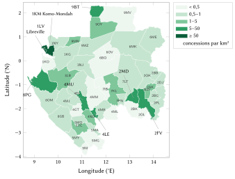
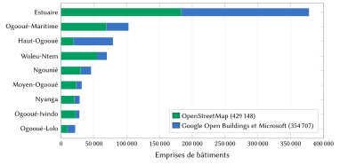
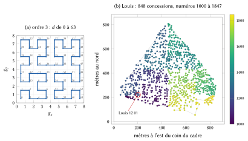
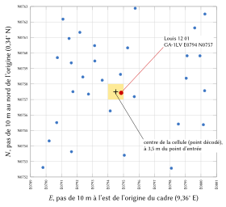

# Introduction

## Le problème

Une adresse indique à un inconnu où se rendre. Au Gabon, la plupart des foyers n’en ont aucune qu’un inconnu puisse suivre. La fiche d’adressage de l’Union postale universelle place un nombre à deux chiffres devant le nom de la ville, mais aucune liste de codes postaux n’a jamais été publiée et aucun n’est employé dans la pratique [@upu2002gabon]. Le courrier est distribué en boîte postale (BP), qui désigne un guichet et non un domicile [@gabonreview2020bp]. Libreville a commencé à nommer ses rues et à numéroter ses portes entre 2012 et 2014, puis a relancé le chantier en 2021 ; en 2024, la presse parlait pourtant encore de « la capitale aux rues sans nom », où l’on indique son domicile par « derrière la prison, à gauche de la boutique » [@mouega2021adressage; @obiang2024rues]. Ailleurs dans le pays, nous n’avons trouvé aucun programme d’adressage des voies.

Les conséquences sont banales et coûteuses. Une livraison ou une course en taxi se termine par un appel téléphonique ; une ambulance atteint le quartier, puis cherche le portail ; une banque ou un employeur demande une adresse qu’on ne sait pas écrire ; une famille de l’étranger envoie un colis à une description. Dans les quartiers périphériques, le long des routes nationales et des fleuves, plusieurs bâtiments partagent un même portail et des villages s’étirent sur des kilomètres sans une rue nommée.

L’adressage classique, pratiqué dans de nombreuses villes africaines depuis les années 1990, nomme les voies, numérote les entrées et tient un fichier des adresses [@farvacque2005]. Il est efficace lorsqu’il est mené à terme et utilisé, mais il est lent et dépend de plaques qu’il faut poser puis entretenir. Dans l’étude de la Banque mondiale portant sur 21 villes, son coût moyen était de 5,7 dollars américains par entrée adressée, aux prix de 2005 [@farvacque2005].

## Contribution

Cet article présente un modèle national d’adressage pour le Gabon et le registre construit à partir de lui. Ses apports sont les suivants :

1. **Un code que l’on peut dire et retenir.** Un code est le nom d’un lieu que les gens emploient déjà, suivi d’un numéro d’au plus cinq chiffres, lu par paires comme un numéro de téléphone : *Louis 12 01*.
2. **L’unicité nationale sans contexte.** Chaque nom possède une plage nationale de numéros, découpée en blocs figés, un par zone qui porte ce nom ; un code désigne ainsi une seule concession dans tout le pays, sans ville, sans province et sans position de l’appareil.
3. **La proximité et la croissance.** Les numéros suivent une courbe de Hilbert sur chaque zone, ménagent des intervalles pour les nouvelles constructions et gardent une réserve : des voisins ont des numéros voisins, et une nouvelle concession peut être numérotée entre eux.
4. **L’intégrité pour les systèmes.** La forme machine porte un chiffre de contrôle de Damm calculé sur le nom, le département, la zone et le numéro ; il détecte toute erreur sur un chiffre et toute inversion de deux chiffres voisins.
5. **Une couverture complète et ouverte.** Les 665 089 concessions recensées dans le pays ont reçu un code le 21 octobre 2026. La spécification, le moteur de référence, le registre et un serveur prêt à déployer sont publiés sous licences ouvertes [@nways2026repo].
6. **Une évaluation et une estimation des effets.** Nous mesurons les propriétés des codes émis et estimons, sous des hypothèses explicites, leurs effets pour les citoyens, la logistique, les services d’urgence et l’État.

## Plan de l’article

La section 2 passe en revue les systèmes postaux, d’adressage et fonciers du Gabon ainsi que la pratique internationale. La section 3 décrit les données. La section 4 expose le modèle règle par règle, chaque formule étant illustrée par un exemple chiffré sur un code réel. La section 5 décrit la mise en œuvre et la section 6 l’évaluation. La section 7 rend compte des formes envisagées puis écartées, mesures à l’appui. Les sections 8 à 11 estiment les bénéfices pour les citoyens, la logistique et le commerce, les services d’urgence et l’action publique. La section 12 traite de la vie privée, de la sécurité et de la gouvernance, la section 13 des limites, et la section 14 conclut.

# Contexte et travaux existants

## Territoire et population

Le Gabon compte neuf provinces, numérotées de GA-1 (Estuaire) à GA-9 (Woleu-Ntem) dans la norme ISO 3166-2. Le Permanent Committee on Geographical Names britannique dénombre cinquante départements au second niveau [@pcgn2023gabon] ; OpenStreetMap en cartographie 49, l’ensemble retenu ici. Le français est la langue officielle ; le fang, le punu, le nzebi, le myènè et bien d’autres langues se parlent à la maison. Le recensement général de 2026 a dénombré 3 518 621 habitants, chiffre validé par la Cour constitutionnelle le 27 août 2026 et presque double des 1 811 079 de 2013 ; environ 60 % de la population vit dans l’Estuaire, autour de Libreville, d’Owendo et d’Akanda [@mouega2026recensement; @mbeng2026population]. Port-Gentil, Franceville, Oyem et Moanda sont les villes suivantes.

## La poste et la boîte postale

La fiche de l’UPU donne deux exemples [@upu2002gabon]. Pour la distribution à domicile, « 05 TCHIBANGA 01 » suit les indications de distribution ; pour la boîte postale, « BP 13210 » est suivi de « 01 LIBREVILLE–GROS-BOUQUET 03 ». La fiche nomme cette ligne « code postal et bureau de distribution ». Les premiers chiffres coïncident avec les numéros ISO des provinces (la Nyanga est GA-5, l’Estuaire GA-1) ; la fiche ne le dit pas, et c’est notre interprétation. Les derniers chiffres désignent le bureau distributeur. Aucune liste de ces codes n’a été publiée et nous n’en avons trouvé aucun usage actuel. Une boîte postale peut servir de domicile légal à une entreprise, et l’on peut en demander une en ligne depuis 2020 [@gabonreview2020bp]. Elle situe un guichet, pas un logement.

## Rues nommées et numéros de porte à Libreville

Le programme d’adressage de Libreville a débuté en 2012–2014. Le 8 juillet 2021, le maire par intérim l’a relancé avec 480 millions de francs CFA apportés par l’Association internationale des maires francophones (AIMF) et l’Union européenne ; sur 6 000 plaques de rue fabriquées, 3 900 restaient à poser, et sur 60 000 numéros de porte nécessaires, 55 000 restaient à placer [@mouega2021adressage; @gabonactu2021adressage]. En mai 2024, le programme, qui visait à nommer 3 650 voies, n’était pas entré dans les usages [@obiang2024rues]. OpenStreetMap recense 3 945 portes dotées d’une rue et d’un numéro à Libreville, Owendo et Akanda, dont 911 relevées sur le terrain. Nous n’avons trouvé de programme comparable dans aucune autre ville.

## Foncier, cadastre et absence de registre d’adresses

L’Agence nationale de l’urbanisme, des travaux topographiques et du cadastre (ANUTTC) gère les titres fonciers, les rebornages et les rectifications de limites ; elle ne publie pas de données parcellaires ouvertes [@anuttc]. La projection nationale du cadastre et des levés est WGS 84 / Gabon TM 2011 [@epsg5523]. Un titre foncier identifie une parcelle et un droit ; il n’indique pas à un livreur où s’arrêter, et la plupart des foyers n’en ont pas. Nous n’avons trouvé ni registre national des adresses, ni loi sur l’adressage, ni géoportail national des adresses.

## La pratique internationale

La norme S42 de l’UPU décrit les éléments des adresses postales et un gabarit par pays [@upuS42], et la norme ISO 19160-1 propose un modèle conceptuel des données d’adresse, alias et cycle de vie compris [@iso19160]. L’une et l’autre décrivent des adresses ; aucune n’en crée là où il n’y en a pas. Le livre blanc de l’UPU de 2012 soutient que l’adresse fait partie des infrastructures nationales et de l’identité sociale et juridique des personnes [@upu2012addressing]. L’étude de la Banque mondiale porte sur 52 villes de 15 pays entre 1989 et 2004 : dans les 21 villes qui ont achevé leurs opérations, 1,2 million de bâtiments ont été adressés pour un coût moyen de 0,6 dollar par habitant, et le fichier des adresses a fourni une liste des locaux plus complète que les rôles fiscaux [@farvacque2005]. La même étude montre que l’adressage se dégrade lorsque les habitants ne s’en servent pas, ce qui justifie notre choix de partir des noms que les gens emploient déjà.

## Codes de grille et adresses numériques nationales

Une seconde famille de systèmes dérive le code des coordonnées. L’Open Location Code (Plus Codes) code un point avec un alphabet de 20 symboles ; la concession *Louis 12 01* se trouve dans la cellule 6FGFCC5J+CH, large d’environ 14 m [@olc]. Dans la région, le système national d’adresses numériques du Ghana découpe le pays en carrés de 5 m et en dérive un code alphanumérique du type GA-543-0125 [@bokpe2017ghana]. Les codes de grille couvrent d’emblée tous les points et ne demandent aucun relevé, mais ils désignent des cellules et non des foyers, mêlent lettres et chiffres qu’il faut épeler, et ne portent aucun nom de lieu qu’un interlocuteur puisse reconnaître. La section 7 compare ces formes à la nôtre. Nous gardons un code de grille pour les points qui ne sont pas des concessions (un étal, un champ, un débarcadère), sans l’utiliser comme adresse d’un foyer.

## La règle retenue : l’adresse officielle d’abord

Là où l’État ou une commune donne une adresse, le modèle l’affiche en premier, telle qu’elle est écrite, avec le code à côté. À Libreville, la rue nommée située à moins de 30 m d’une concession s’affiche en premier sur 37 622 concessions ; un numéro de porte du plan communal la remplace dès qu’il est connu (par les données de la commune, par les portes relevées dans OpenStreetMap ou par la confirmation des habitants). Chaque département garde un champ réservé à un code postal, à remplir le jour où il sera publié. Aucun code ne change lorsqu’une adresse officielle apparaît.

# Données et sources

Toutes les données d’entrée sont ouvertes ; le tableau 1 les récapitule. Les chiffres de cet article sont calculés à partir du registre et des fichiers du modèle publiés, et peuvent être reproduits depuis le dépôt [@nways2026repo].

| Donnée | Source | Licence | Usage |
|:------|:------------|:-----|:--------|
| Emprises de bâtiments | OpenStreetMap [@haklay2008osm; @geofabrik2026gabon] | ODbL 1.0 | structures (429 148) |
| Emprises de bâtiments | Google Open Buildings [@sirko2021openbuildings], Microsoft [@microsoft2023footprints], via Overture Maps [@overture2026buildings] | CC BY 4.0 / ODbL 1.0 | structures sans recouvrement avec un bâtiment OpenStreetMap (354 707) |
| Murs, clôtures, haies, portails | OpenStreetMap | ODbL 1.0 | enceintes des concessions (179 utilisées pour la validation) |
| Lieux | lieux OpenStreetMap ; lieux habités GeoNames [@geonames] | ODbL 1.0 / CC BY 4.0 | les 4 922 zones d’adressage |
| Départements | limites administratives OpenStreetMap | ODbL 1.0 | les 49 départements |
| Rues nommées | voies OpenStreetMap de Libreville | ODbL 1.0 | rue officielle affichée en premier |
| Équipements | OpenStreetMap et autres jeux de lieux ouverts | licences ouvertes diverses | accès aux services (section 11) |

: Données d’entrée du modèle.

**Emprises de bâtiments.** Nous prenons tous les bâtiments OpenStreetMap situés au Gabon et y ajoutons les emprises de Google et de Microsoft qu’aucun bâtiment OpenStreetMap ne recouvre. Les emprises issues de l’apprentissage automatique doublent la couverture dans l’Estuaire et sont majoritaires dans le Haut-Ogooué, où la carte OpenStreetMap est clairsemée (figure 2). Les emprises de moins de 1 m² sont écartées. L’attribut de hauteur des emprises apprises est une valeur de rendu ; il ne sert jamais à déduire un nombre d’étages.

{width=88%}

{width=88%}

**Lieux et noms.** Une zone d’adressage est un lieu nommé d’un département : un lieu OpenStreetMap (ville, bourg, quartier, faubourg, voisinage, village, hameau, lieu-dit) ou un lieu habité GeoNames. Un lieu GeoNames situé à moins de 1 km d’un lieu OpenStreetMap de même nom est considéré comme le même lieu, et un second lieu de même nom à moins de 300 m est écarté. Seuls 88 faubourgs et 49 quartiers sont cartographiés dans tout le pays, si bien que plusieurs villes sont représentées par un point unique ; nous y revenons à la section 13.

**Limites.** Les 49 polygones départementaux (figure 1) sont figés avec le registre. La province se déduit de la position d’une concession et n’entre dans aucun code.

# Le modèle

## Exigences

Le modèle répond à onze exigences, par ordre de priorité : (i) un code se dit, s’entend et se retient facilement, et l’obtenir demande un seul geste ; (ii) il est unique dans tout le pays à lui seul ; (iii) il désigne une concession et mène à son portail ; (iv) l’adresse officielle passe d’abord, là où elle existe ; (v) il emploie la langue des habitants ; (vi) il ne peut se confondre avec une boîte postale, un numéro de téléphone ou un titre foncier ; (vii) il se résout hors connexion ; (viii) il est stable et n’est jamais réutilisé ; (ix) il décrit des lieux, jamais des personnes ; (x) il est ouvert et transférable à l’État ; (xi) il est propre au Gabon et ne partage aucun code avec le système d’un autre pays.

## Les formes d’un code

Un code se présente sous plusieurs formes, réunies dans le tableau 2. Les personnes utilisent la forme mémorisée, les systèmes la forme machine.

| Forme | Exemple | Utilisée par |
|:------|:-----------|:-----------|
| Mémorisée | **Louis 12 01**, dit « Louis, douze, zéro un » | les personnes : à l’oral, au clavier, sur un colis |
| Cinq chiffres | **Port-Gentil 12 181**, dit « douze, cent quatre-vingt-un » | les noms les plus grands et les plus répétés |
| Trois chiffres | **Abongo 181**, dit « cent quatre-vingt-un » | les petites zones |
| Machine | `GA-1LV-070-1201-1` | applications, codes QR, partenaires ; le dernier chiffre est le contrôle |
| Structure, entrée | `GA-1LV-070-1201-1.2/1` | un bâtiment de la concession ; l’un de ses portails |
| Point | `GA-1LV E0794 N0757` | tout point : un étal, un champ, un débarcadère |
| Officielle | *Avenue Joseph Deemin, Libreville* ; un numéro de porte dès qu’il est connu | l’adresse de la commune, affichée en premier |

: Les formes d’un même code.

Soit $P$ le nom de plaque d’une zone et $N$ son numéro de trois, quatre ou cinq chiffres. La forme mémorisée est $P$ suivi de $N$ groupé par paires à partir de la gauche (quatre chiffres : $AB\,CD$ ; cinq : $AB\,CDE$ ; trois : $ABC$). La forme machine s’écrit

$$
\texttt{GA-}Z\texttt{-}I\texttt{-}N\texttt{-}c,
\tag{1}
$$

où $Z$ est la clé à trois caractères du département (section 4.3), $I$ l’indice à trois chiffres de la zone dans son département et $c$ le chiffre de contrôle de la section 4.10. Un nom de plaque ne contient jamais de chiffre : le numéro commence donc toujours au premier chiffre du texte.

## Départements et zones d’adressage

Chaque département reçoit une clé de trois caractères, le numéro ISO de sa province suivi de deux lettres (**1LV** Libreville, **8PG** Bendje avec Port-Gentil, **9OY** Woleu avec Oyem) : un agent postal qui lit 1LV reconnaît l’Estuaire comme sur la fiche UPU de 2002. Chacun reçoit aussi un indice figé $z \in \{0, \dots, 48\}$.

Chaque emprise $f$ appartient au point de lieu le plus proche de son propre département. En notant $(\lambda, \varphi)$ la longitude et la latitude en degrés et $\mathcal{A}_{z(f)}$ les zones du département de l’emprise,

$$
a(f) = \operatorname*{arg\,min}_{a \in \mathcal{A}_{z(f)}} \left[ (\lambda_f - \lambda_a)^2 \cos^2 \varphi_f + (\varphi_f - \varphi_a)^2 \right],
\tag{2}
$$

les égalités étant tranchées en faveur de la plus petite clé. Sur les 4 922 zones, 2 932 contiennent au moins une concession. La plus grande, Le Transfo à Port-Gentil, en compte 13 031 ; Libreville a 114 zones et 191 073 concessions, Port-Gentil 104 zones et 65 469 concessions. La figure 3 montre la distribution des tailles. Chaque zone est figée à la première émission : sa clé, son bloc de numéros et son *cadre*, le rectangle englobant les centres de ses emprises élargi de 0,0005° de chaque côté, sur lequel ses numéros sont disposés.

{width=88%}

## Noms de plaque

Le nom inscrit dans un code est un *nom de plaque*, assez court pour être peint sur un portail et prononcé d’un trait. En notant $\mathrm{NFC}(s)$ le nom normalisé en Unicode, $W(s)$ ses mots et $L$ les mots de liaison *de, du, des, d, la, le, les, l, et, sur, en, au, aux, à*, un nom de plaque doit vérifier

$$
\mathrm{ok}(s) \iff |\mathrm{NFC}(s)| \le 12 \;\wedge\; |W(s) \setminus L| \le 2 \;\wedge\; s \text{ ne contient aucun chiffre}.
\tag{3}
$$

Un nom qui ne satisfait pas l’éq. (3) suit des étapes fixes, la première qui aboutit l’emportant : le nettoyage (parenthèses ; mots génériques *Quartier*, *Carrefour*, *Cité*, *Campement*, *Village* : « Cité Damas » devient **Damas**) ; l’abréviation de « Saint » en « St » ; enfin la suite de mots entiers la plus distinctive, retenue seulement lorsqu’elle se détache nettement. Un mot n’est jamais coupé. Une liste de mots courants du français (*mission*, *catholique*, *carrefour*, *institut*, *sports*, *cimetière*, *poteau*…) compte comme faible, de sorte que la forme courte garde le nom propre (« Mongo Milando » devient **Milando**) et jamais le seul mot-repère. Lorsque toute forme courte contiendrait un chiffre, ne serait faite que de mots courants ou reprendrait le nom d’une autre ville, la zone porte provisoirement le chef-lieu de son département jusqu’au choix de la commune (« Institut des Sports » s’appelle pour l’instant **Libreville**).

Trois règles fixent l’orthographe. Les variantes d’un même nom (accents, majuscules, traits d’union) prennent une seule plaque : celle qui tient dans la limite, puis celle qui porte ses accents (« Akébé-Ville » et non « Akebe Ville »), puis celle sous laquelle vivent le plus d’habitants. Les capitales des sources s’écrivent comme un nom (MIMBOTI devient **Mimboti**), sauf les sigles d’entreprises et d’organismes publics (SETRAG, SOMIMA). Une graphie documentée l’emporte sur celle de la carte : **Mont-Bouët**, comme l’écrivent la ville et la presse, plutôt que « Mont Bouet ».

| Zones | Nombre |
|:---------------|-----:|
| Nom de plaque identique au nom officiel | 4 508 |
| Nettoyé / réduit à ses mots distinctifs / abrégé | 22 / 132 / 8 |
| Provisoire, laissé au choix de la commune avec des candidats | 252 |
| dont encore au-delà de la limite de l’éq. (3) | 115 |
| Noms officiels de plus de 12 caractères ou de 2 mots | 406 |

: Résultat des règles de nom de plaque pour les 4 922 zones.

Les 252 noms provisoires (tableau 3) couvrent 87 684 concessions, numérotées sous un nom que leur commune pourra changer une fois. Le nom officiel reste toujours un alias (261 alias conservés ; 5 abandonnés parce que deux noms de plaque les revendiquent) : taper le nom complet mène à la même concession.

## La clé de nom

Deux graphies désignent le même nom lorsqu’elles ont la même *clé* :

$$
\text{clé} = \text{resserrer} \circ \text{replier} \circ \text{joindre} \circ \text{article} \circ \text{tête} \circ \text{saint} \circ \text{majuscules} \circ \text{désaccentuer}.
\tag{4}
$$

| Étape | Règle | Exemple |
|:------|:---------------|:----------|
| désaccentuer, majuscules | diacritiques et casse supprimés | Akébé → AKEBE |
| saint, tête, article | St, Ste → Saint, Sainte ; *Quartier* ou *Village de* initial et *le, la, les, l’* supprimés | Quartier Louis → LOUIS |
| joindre | tout caractère hors A–Z et 0–9 supprimé | Nzeng-Ayong → NZENGAYONG |
| replier | tch, ch → c ; dj → j ; gh → g ; ph → f ; ck → k ; ou, w → u ; gu devant i ou e → g | Mont-Bouët = Mont Bouet ; Mbogha = Mboga |
| resserrer | une lettre doublée écrite une fois ; les chiffres jamais | Kotto = Koto |

: Les étapes de la clé de nom, éq. (4).

Le repli ne peut que fusionner des noms, jamais en séparer un (tableau 4). Les 4 922 zones portent 3 737 noms de plaque distincts ; 713 noms sont partagés, par 1 898 zones. Mandji est porté par 18 zones, Aléné par 11, le nom provisoire Libreville par 10, Bissobinam, Mbomo et Moukouagna par 9 chacun.

## Plages nationales par nom

Chaque nom possède une plage nationale : 100–999, 1000–9999 ou 10000–99999. La règle de capacité veut que le bloc d’une zone contienne au moins deux fois ses concessions. Pour une zone de $c$ concessions,

$$
B(c) = \max\!\left(20,\; 10 \left\lceil \frac{2c}{10} \right\rceil \right).
\tag{5}
$$

Pour un nom dont les zones comptent $c_1, \dots, c_k$ concessions, prises dans l’ordre figé de leurs clés (département, puis indice de zone), le total et le nombre de chiffres valent

$$
T = \sum_{i=1}^{k} B(c_i), \qquad
d = \min\left\{ d' \in \{3, 4, 5\} \;:\; T \le \left\lfloor 0{,}9 \cdot 9 \cdot 10^{d'-1} \right\rfloor \right\},
\tag{6}
$$

soit des limites de 810, 8 100 et 81 000 : le dixième supérieur de chaque plage reste toujours libre. Les blocs sont posés bout à bout à partir de $10^{d-1}$. Une zone sans concession ne reçoit pas de bloc avant sa première concession.

**Exemple chiffré : Louis.** Une seule zone de Libreville porte ce nom, avec $c = 848$ concessions. L’éq. (5) donne $B = 10 \lceil 1696/10 \rceil = 1700$, d’où le bloc 1000–2699. Comme $810 < T = 1700 \le 8100$, l’éq. (6) donne $d = 4$, et 2700–9999 restent libres.

**Exemple chiffré : Le Transfo,** la plus grande zone, $c = 13\,031$ : $B = 26\,070$, bloc 10000–36069, $d = 5$, 36070–99999 libres.

**Exemple chiffré : Mandji,** le nom le plus répété. Sur ses 18 zones, 10 contiennent des concessions ; leurs blocs totalisent $T = 3\,210 \le 8\,100$ : le nom a quatre chiffres et ses blocs occupent 1000–4209 (figure 5). **Mandji 10 20** se trouve dans l’Ogooué-et-Lacs et **Mandji 39 50** dans l’Offoué-Onoye : le numéro suffit à désigner la zone.

{width=88%}

{width=100%}

Le tableau 5 donne le résultat pour 2026 : 2 505 zones ont trois chiffres, 368 quatre et 59 cinq. Aucun nom n’a besoin d’un qualificatif et aucune zone n’a dû être scindée (figure 4). **Croissance.** Une nouvelle zone portant un nom existant, ou une zone dont le bloc est plein, prend le bloc suivant au-dessus de tous les blocs de son nom ; un bloc n’est jamais déplacé, réduit ni renuméroté.

| Chiffres | Zones | Concessions | Part des concessions |
|:--|--:|--:|--:|
| 3 | 2 505 | 126 930 | 19,1 % |
| 4 | 368 | 332 650 | 50,0 % |
| 5 | 59 | 205 509 | 30,9 % |

: Nombre de chiffres des numéros émis.

## Numérotation dans une zone

Les concessions sont numérotées le long d’une courbe de Hilbert [@hilbert1891] d’ordre $k = 16$ posée sur le cadre de la zone $(x_0, y_0, x_1, y_1)$, au point de référence de chaque concession (le centre de son plus grand bâtiment tant qu’aucun portail n’est confirmé). Le point est d’abord ramené sur la grille

$$
g_x = \left\lfloor \frac{\lambda - x_0}{x_1 - x_0} \,(2^k - 1) \right\rfloor, \qquad
g_y = \left\lfloor \frac{\varphi - y_0}{y_1 - y_0} \,(2^k - 1) \right\rfloor.
\tag{7}
$$

Sa distance $h$ le long de la courbe s’accumule ensuite pour $s = 2^{k-1}, 2^{k-2}, \dots, 1$, à partir de $h = 0$ :

$$
\begin{gathered}
r_x = \left\lfloor g_x / s \right\rfloor \bmod 2, \qquad
r_y = \left\lfloor g_y / s \right\rfloor \bmod 2, \qquad
h \leftarrow h + s^2 \left( 3 r_x \oplus r_y \right), \\
(g_x, g_y) \leftarrow
\begin{cases}
(g_y,\, g_x) & \text{si } r_y = 0 \text{ et } r_x = 0,\\
(2^k - 1 - g_y,\; 2^k - 1 - g_x) & \text{si } r_y = 0 \text{ et } r_x = 1,\\
(g_x,\, g_y) & \text{si } r_y = 1,
\end{cases}
\end{gathered}
\tag{8}
$$

où $\oplus$ désigne le ou exclusif bit à bit. La courbe de Hilbert préserve mieux la proximité que les autres ordres courants [@moon2001hilbert] : des concessions proches sur le terrain reçoivent des numéros proches (figure 6 ; la section 6.5 le mesure).

Soit $[F, F + B)$ le bloc de la zone et ses $n$ concessions triées selon $(h, \text{identifiant stable})$ et indexées par $i = 0, \dots, n - 1$. Les numéros valent

$$
M = \left\lfloor \tfrac{2B}{3} \right\rfloor, \qquad
\sigma = \max\!\left(1,\; \left\lfloor \frac{M}{\lfloor 1{,}5\, n \rfloor} \right\rfloor \right), \qquad
N_i = F + i\,\sigma,
\tag{9}
$$

et la réserve de queue $[F + M, F + B)$ reste inutilisée à la première émission. Comme $n \le B/2$ d’après l’éq. (5), le dernier numéro $F + (n-1)\sigma$ tombe toujours dans la partie principale.

**Exemple chiffré : Louis 12 01.** Le point de référence de la concession est $\varphi = 0{,}4085002$, $\lambda = 9{,}4314043$, et le cadre de Louis vaut $(9{,}429597 ;\ 0{,}406494 ;\ 9{,}437690 ;\ 0{,}414309)$. L’éq. (7) donne

$$
g_x = \left\lfloor \frac{0{,}0018073}{0{,}008093} \cdot 65\,535 \right\rfloor = 14\,635, \qquad
g_y = \left\lfloor \frac{0{,}0020062}{0{,}007815} \cdot 65\,535 \right\rfloor = 16\,823,
$$

et l’éq. (8) donne $h = 896\,033\,648$, la 202ᵉ des 848 positions le long de la courbe ($i = 201$). Avec $B = 1700$, l’éq. (9) donne $M = 1133$, $\sigma = \max(1, \lfloor 1133 / 1272 \rfloor) = 1$ et $N = 1000 + 201 = 1201$ ; la réserve de queue va de 2133 à 2699.

{width=100%}

## Nouvelles concessions

Une concession bâtie après la première émission est placée sur la courbe par l’éq. (8). Soit $a$ le numéro de sa précédente sur la courbe (toute concession émise compte, retirées comprises ; $a = F - 1$ s’il n’y en a pas) et $b$ celui de sa suivante ($b = F + M$ s’il n’y en a pas), et soit $\Phi$ l’ensemble des numéros libres $x$ tels que $a < x < b$ et $F \le x < F + M$. Avec $m = \lfloor (a + b)/2 \rfloor$, le nouveau numéro est

$$
x^{*} = \operatorname*{arg\,min}_{x \in \Phi} \big( |x - m|,\; [x > m] \big),
\tag{10}
$$

c’est-à-dire $m$, puis $m - 1$, $m + 1$, $m - 2$… Si $\Phi$ est vide, on prend le plus petit numéro libre de la réserve de queue, puis celui des blocs suivants de la zone, et enfin un nouveau bloc de taille $B(n + 1)$ pris dans la réserve du nom, au-dessus de tous les blocs existants. Un numéro n’est jamais attribué deux fois : les numéros retirés restent pris. À Louis, le pas vaut 1 : une maison construite entre deux voisines reçoit **Louis 21 33**, le premier numéro de la réserve de queue.

## Décoder sans contexte

Un texte se lit comme un nom suivi d’un numéro de trois à cinq chiffres, avec ou sans espaces. En notant $K(a)$ les clés du nom de plaque et des alias d’une zone, $d(a)$ le nombre de chiffres de son nom et $\mathcal{B}(a)$ ses blocs, l’ensemble décodé est

$$
D(P, N) = \left\{ a \;:\; \text{clé}(P) \in K(a),\; |N| = d(a),\; N \in \mathcal{B}(a) \right\},
\tag{11}
$$

qui, par construction, contient au plus une zone. Un numéro hors de tout bloc, dans la réserve d’un nom ou au mauvais nombre de chiffres est déclaré non émis, jamais deviné. Le décodage n’utilise aucun contexte : ni la position de l’utilisateur, ni la région de l’appareil, ni une ville écrite après une virgule.

## Le chiffre de contrôle

Le chiffre de contrôle est calculé par l’algorithme de Damm [@damm2004; @damm2007] sur la concaténation

$$
\delta = i_5 \,\Vert\, z_3 \,\Vert\, I_3 \,\Vert\, N, \qquad
c_0 = 0, \quad c_j = Q[c_{j-1}][\delta_j], \quad c = c_{|\delta|},
\tag{12}
$$

où $i_5$ est l’indice national du nom sur cinq chiffres, $z_3$ l’indice du département, $I_3$ l’indice de la zone et $Q$ la table d’un quasigroupe totalement antisymétrique d’ordre 10 (tableau 6).

| $Q$ | 0 | 1 | 2 | 3 | 4 | 5 | 6 | 7 | 8 | 9 |
|:-:|:-:|:-:|:-:|:-:|:-:|:-:|:-:|:-:|:-:|:-:|
| **0** | 0 | 3 | 1 | 7 | 5 | 9 | 8 | 6 | 4 | 2 |
| **1** | 7 | 0 | 9 | 2 | 1 | 5 | 4 | 8 | 6 | 3 |
| **2** | 4 | 2 | 0 | 6 | 8 | 7 | 1 | 3 | 5 | 9 |
| **3** | 1 | 7 | 5 | 0 | 9 | 8 | 3 | 4 | 2 | 6 |
| **4** | 6 | 1 | 2 | 3 | 0 | 4 | 5 | 9 | 7 | 8 |
| **5** | 3 | 6 | 7 | 4 | 2 | 0 | 9 | 5 | 8 | 1 |
| **6** | 5 | 8 | 6 | 9 | 7 | 2 | 0 | 1 | 3 | 4 |
| **7** | 8 | 9 | 4 | 5 | 3 | 6 | 2 | 0 | 1 | 7 |
| **8** | 9 | 4 | 3 | 8 | 6 | 1 | 7 | 2 | 0 | 5 |
| **9** | 2 | 5 | 8 | 1 | 4 | 3 | 6 | 7 | 9 | 0 |

: Table du quasigroupe de Damm $Q$ : ligne $c_{j-1}$, colonne $\delta_j$.

**Exemple chiffré.** Louis a l’indice national 1801, Libreville l’indice 003 et la zone l’indice 070, d’où $\delta = 01801\,003\,070\,1201$. Les valeurs successives de $c_j$ sont 0, 3, 2, 4, 1, 7, 8, 8, 9, 7, 8, 4, 2, 4, 1 : $c = 1$, et la forme machine est `GA-1LV-070-1201-1`.

Toute erreur sur un chiffre et toute inversion de deux chiffres voisins différents modifient le contrôle [@damm2007], propriété obtenue d’abord pour les codes décimaux par Verhoeff à l’aide du groupe diédral [@verhoeff1969]. Comme l’indice du nom, le département et la zone entrent dans $\delta$, un numéro transporté dans une autre zone du même nom échoue à la fois au contrôle et au test de bloc de l’éq. (11). Le contrôle ne figure que dans la forme machine ; il n’est jamais montré ni demandé aux personnes.

## Codes de point

Tout point possède un code de point sur une grille de 10 m posée sur le cadre figé de son département, dont l’origine $(\lambda_0, \varphi_0)$ est le coin sud-ouest du rectangle englobant arrondi par défaut à 0,01°, et dont la latitude de référence $\varphi_c$ est le centre de ce rectangle arrondi à 0,01°. Avec $k_x$ et $k_y$ les mètres par degré,

$$
k_x = 111\,320 \cos \varphi_c, \qquad k_y = 110\,574,
\tag{13}
$$

$$
X = \left\lfloor \frac{(\lambda - \lambda_0)\, k_x}{10} \right\rfloor, \qquad
Y = \left\lfloor \frac{(\varphi - \varphi_0)\, k_y}{10} \right\rfloor,
\tag{14}
$$

et le code s’écrit $\texttt{GA-}Z\ \texttt{E}X\ \texttt{N}Y$, avec quatre chiffres par axe, ou cinq lorsque le département s’étend sur plus de 99,99 km. Le décodage rend le centre de la cellule, $\hat\lambda = \lambda_0 + 10 (X + \tfrac12)/k_x$ et $\hat\varphi = \varphi_0 + 10 (Y + \tfrac12)/k_y$ ; l’erreur est donc bornée par la demi-diagonale de la cellule :

$$
\left\| (\hat\lambda, \hat\varphi) - (\lambda, \varphi) \right\| \le 5\sqrt{2} \approx 7{,}07 \text{ m}.
\tag{15}
$$

**Exemple chiffré.** Pour Louis 12 01 dans le cadre de Libreville ($\lambda_0 = 9{,}36$, $\varphi_0 = 0{,}34$, $\varphi_c = 0{,}45$) : $k_x = 111\,317$, $X = \lfloor 0{,}0714043 \cdot 111\,317 / 10 \rfloor = \lfloor 794{,}85 \rfloor = 794$ et $Y = \lfloor 0{,}0685002 \cdot 110\,574 / 10 \rfloor = \lfloor 757{,}43 \rfloor = 757$, soit `GA-1LV E0794 N0757`. Le centre décodé se trouve à 3,5 m du point de référence (figure 7).

{width=72%}

**Points hors de tout contour.** Les contours des départements sont généralisés : 80 concessions émises ne se trouvent dans aucun contour, dans des interstices entre départements, sur le rivage ou sur des îles, la plus éloignée à 18,4 km d’un contour. Un tel point prend son département parmi ceux dont le contour se trouve à moins de 20 km : celui dont le contour est le plus proche et dont le cadre contient le point, la distance étant mesurée jusqu’à l’arête la plus proche, les écarts de longitude multipliés par $\cos\varphi$, et une égalité revenant à la clé la plus basse ; si aucun de ces cadres ne contient le point, la cellule la plus proche d’un cadre situé à 1 000 m au plus. Les cadres ne sont jamais déplacés ni élargis, car l’un comme l’autre changerait des codes de point déjà publiés, et le décodeur ne change pas, puisqu’un code de point nomme son département. Toute concession émise a donc un code de point. Ainsi, une concession de Moka en $\varphi = 0{,}8104524$, $\lambda = 9{,}3792151$, sur une île à 18,4 km du contour le plus proche, celui du Komo-Mondah, tombe dans le cadre du Komo-Mondah et reçoit `GA-1KM E0881 N6971`.

## Des emprises aux concessions

Un code appartient à une concession, non à un bâtiment. Les emprises sont regroupées zone par zone, dans un ordre fixe selon leur identifiant stable, avant toute numérotation. En notant $\mathrm{dist}(a, b)$ la plus courte distance entre deux contours (nulle s’ils se touchent ou se chevauchent) et $A(f)$ la surface de l’emprise $f$, une annexe $f$ telle que $A(f) < 25$ m² rejoint

$$
g^{*}(f) = \operatorname*{arg\,min}_{g \,:\, A(g) \ge 25 \text{ m}^2,\ \mathrm{dist}(f, g) \le 8 \text{ m}} \mathrm{dist}(f, g).
\tag{16}
$$

Les règles complètes figurent au tableau 7. Seules les annexes rejoignent une maison, et un groupe de cases ne réunit jamais deux maisons : les regroupements ne peuvent pas s’enchaîner.

| Règle | Condition | Effet |
|:----|:---------------|:--------|
| Enceinte | le centre de l’emprise est dans un mur, une clôture ou une haie fermés cartographiés, d’au plus 6 000 m² | l’enceinte forme une concession |
| Annexe | une emprise de moins de 25 m² (cuisine, douche, magasin) | rejoint sa maison selon l’éq. (16) |
| Groupe de cases | hors de Libreville et de Bendje : cases de moins de 40 m² rattachées à aucune maison, à au plus 3 m l’une de l’autre | une concession d’au plus 25 cases |
| Isolée | toute autre emprise | sa propre concession |

: Règles de regroupement, appliquées dans l’ordre.

Les 783 855 emprises forment 665 089 concessions, soit 1,18 emprise par concession : 566 928 bâtiments isolés, 92 635 maisons avec leurs annexes, 5 288 groupes de cases et 238 enceintes cartographiées. Par taille, 566 985 concessions comptent une structure, 82 186 deux, 12 644 trois et 3 274 quatre ou plus. L’emprise médiane mesure 70 m². Le tableau 8 détaille les chiffres par province.

| Province | Concessions | Emprises | Emprise médiane |
|:--|--:|--:|--:|
| Estuaire | 327 833 | 378 121 | 72,5 m² |
| Ogooué-Maritime | 78 404 | 102 729 | 45,3 m² |
| Haut-Ogooué | 67 390 | 79 025 | 67,6 m² |
| Woleu-Ntem | 60 822 | 69 755 | 65,1 m² |
| Ngounié | 38 689 | 45 530 | 56,9 m² |
| Moyen-Ogooué | 26 887 | 31 351 | 55,7 m² |
| Ogooué-Ivindo | 24 046 | 27 749 | 60,6 m² |
| Nyanga | 22 724 | 28 169 | 48,8 m² |
| Ogooué-Lolo | 18 294 | 21 426 | 66,3 m² |

: Concessions et emprises par province.

Les règles sont volontairement prudentes. Fusionner deux codes plus tard ne coûte rien, alors que séparer une fusion erronée donnerait un nouveau code à un ménage. Les réponses des habitants dans l’application (« ces bâtiments forment un seul foyer », « voici le portail ») complètent le regroupement là où les murs ne sont pas cartographiés.

## Profil des bâtiments

Chaque structure porte une classe d’usage avec un degré de confiance et une source, sa taille, son nombre d’étages s’il est connu et un statut. Les classes sont déduites dans un ordre fixe : le type de bâtiment OpenStreetMap (confiance 0,85), une étiquette de commerce, d’équipement ou de bureau sur l’emprise (0,75), un lieu ouvert situé à l’intérieur (0,65), la taille de l’emprise (0,3–0,4), et à défaut *résidentiel* (0,45). Le tableau 9 donne le résultat.

| Classe | Structures |
|:---------------|-----:|
| résidentiel (surtout par défaut) | 773 037 |
| annexe | 5 501 |
| commerce | 1 946 |
| enseignement | 725 |
| industrie | 600 |
| bureaux | 510 |
| santé | 400 |
| hébergement | 325 |
| culte | 269 |
| administration | 119 |
| autres (ruine, chantier, mixte, transport, agricole) | 423 |

: Classes d’usage des 783 855 structures.

OpenStreetMap renseigne le nombre d’étages de 491 bâtiments. Un foyer ne porte jamais de nom ; les bâtiments commerciaux et publics portent seulement leur nom public.

# Mise en œuvre

## Moteur de référence

La spécification (`engine/SPEC.md`) énonce chaque règle de façon normative. Le moteur de référence (`engine/reference/ga_engine.py`) l’implémente avec la seule bibliothèque standard de Python : clés de nom (éq. 4), contrôle des noms de plaque (éq. 3), tailles de bloc (éq. 5–6), indice de Hilbert (éq. 7–8), numérotation (éq. 9–10), décodage (éq. 11), chiffre de contrôle (éq. 12), codes de point (éq. 13–15) et regroupement des emprises (éq. 16). Un second module dérive les noms de plaque. Le moteur est livré avec le registre figé des zones, des noms, des blocs et des cadres (`engine/data/`), environ 3 Mo, si bien qu’un appareil peut résoudre tout code hors connexion.

## Registre

Le registre (`registry/`) publie tous les codes émis : un fichier CSV compressé par département avec une ligne par concession (formes machine, mémorisée et écrite, zone, numéro, contrôle, statut, date d’émission, point d’entrée, code de point, adresse officielle, classe d’usage, structures et surface bâtie), la table figée des zones, et un manifeste donnant le nombre de lignes et l’empreinte SHA-256 de chaque fichier. Toutes les concessions de tous les départements sont publiées ; les lignes ne contiennent rien sur les personnes qui y vivent.

## Serveur et API

Un serveur prêt à l’emploi (`server/`) permet à un ministère, à un opérateur postal ou à un développeur de servir le registre en une commande, avec Docker ou avec Python 3.9 seul, sans paquet tiers. Il importe le registre dans SQLite avec des index sur toutes les formes et un index spatial R\*-tree [@guttman1984; @beckmann1990], en vérifiant l’empreinte de chaque fichier et les totaux par rapport au manifeste et en refusant toute discordance. Il sert une API JSON sous `/v1` : recherche d’un code sous toutes ses formes, code en un point, codes proches d’un point, validation, codes de point, départements, zones et listes paginées, le tout décrit en OpenAPI 3.1 [@openapi31] avec des exemples enregistrés. Il peut réexporter le registre au format publié ; après une importation, l’export décompressé est identique octet pour octet aux fichiers publiés.

Le serveur peut aussi émettre des codes pour de nouvelles concessions et de nouvelles entrées selon les règles des sections 4.8 et 4.12, mais seulement s’il a été désigné comme émetteur du pays. L’émission doit être confiée à un seul émetteur par pays : deux émetteurs verraient le même numéro libre et le donneraient à deux foyers. Un déploiement qui n’a été désigné ni par l’État ni par N-WAYS LIMITED fonctionne donc en lecture seule.

## Conformité et parité

Une implémentation est conforme lorsqu’elle reproduit les vecteurs de conformité publiés avec le moteur (`vectors.json`) : 724 clés de nom, 500 formes de code, 2 394 décodages avec et sans chiffre de contrôle, 588 codes de point, 310 points hors de tout contour départemental (dont les 80 concessions émises, des points au-delà d’un cadre et des refus), 5 indices de Hilbert, 6 cas de regroupement et 4 cas de numérotation sur une zone réelle avec de nouvelles maisons, soit 4 531 au total. Les 15 tests du moteur et les 31 tests du serveur passent. L’émission du serveur a été comparée à celle de l’émetteur en production sur 62 cas d’émission, 5 cas d’insertion et 300 points tirés au hasard, avec des résultats identiques.

# Évaluation

Le tableau 10 résume les propriétés mesurées du registre émis ; les sous-sections en donnent le détail.

| Propriété | Mesure | Résultat |
|:-----|:------------|:-----------|
| Unicité | formes machine distinctes ; formes mémorisées distinctes (par clé de nom) | 665 089 et 665 089 sur 665 089 |
| Ambiguïté évitée | codes partageant nom et numéro avec une numérotation par zone | 150 090 (22,6 %), aucun avec les plages nationales |
| Longueur du numéro | chiffres moyens par code ; maximum | 4,12 ; 5 |
| Longueur du nom | caractères moyens, zones habitées ; noms de plus de 12 caractères | 7,5 ; 75, tous provisoires |
| Décodage | formes écrites de 50 000 codes tirés au hasard ; 20 000 tapés en minuscules sans accents | 100 % et 100 % corrects |
| Détection d’erreurs | substitutions d’un chiffre ; inversions de chiffres voisins (2 000 codes) | 145 818 et 12 730, toutes détectées |
| Codes de point | distance du point de référence au centre décodé | moyenne 3,82 m, maximum 7,07 m |
| Reproductibilité | zones dont les numéros émis égalent l’éq. (9) recalculée depuis le registre | 2 932 sur 2 932 |

: Propriétés mesurées du registre émis le 21 octobre 2026.

## Unicité et ambiguïté

Les 665 089 formes machine sont toutes distinctes, de même que les formes mémorisées, même après réduction de chaque nom à sa clé (éq. 4). Sur les 3 737 noms, 373 sont portés par plusieurs zones habitées ; ensemble, celles-ci réunissent 259 144 concessions, 39 % du total. Si chaque zone avait été numérotée depuis le début de sa propre plage, comme dans la première forme que nous avions envisagée (section 7.2), 150 090 codes (22,6 %) partageraient leur nom et leur numéro avec un code d’une autre zone, en 64 701 paires ou groupes en collision. Les plages nationales suppriment toutes ces collisions sans ajouter de chiffre à aucun code qui tient en cinq.

## Longueur

Le numéro compte en moyenne 4,12 chiffres et aucun ne dépasse cinq (tableau 5). Les noms de plaque des 2 932 zones habitées comptent 7,5 caractères en moyenne, et 7,8 lorsqu’on les pondère par les codes qui les portent. Soixante-quinze noms en usage dépassent 12 caractères ; ce sont tous des noms provisoires en attente du choix d’une commune, qui couvrent 17 122 concessions.

## Décodage

Nous avons décodé les formes écrites de 50 000 codes tirés au hasard dans le registre, puis 20 000 d’entre eux tapés en minuscules et sans aucun accent, comme on le ferait sur un téléphone. Tous ont été ramenés à leur propre forme machine, sans aucune fausse correspondance.

## Détection d’erreurs

Pour 2 000 codes tirés au hasard, nous avons engendré toutes les substitutions d’un chiffre et toutes les inversions de chiffres voisins dans la partie visible de la forme machine (indice de zone, numéro et contrôle). Les 145 818 substitutions et les 12 730 inversions ont toutes été détectées, comme le garantit la théorie [@damm2007]. Les erreurs que cette garantie ne couvre pas ont aussi été largement interceptées : 89,7 % des 10 938 inversions à distance deux ($abc \to cba$) et 89,6 % des 13 248 erreurs jumelles ($aa \to bb$).

## Proximité de la numérotation

Nous avons mesuré la distance au sol entre concessions de numéros consécutifs dans toutes les zones d’au moins 50 concessions de six départements (Libreville, Bendje, Woleu, Mpassa, Ogooué-et-Lacs et Douya-Onoye : 350 235 paires). Le tableau 11 compare l’ordre de Hilbert à une courbe de Morton (ordre Z) et à un balayage en bandes horizontales sur la même grille.

| Ordre | Distance moyenne | 90ᵉ centile | Paires à plus de 100 m |
|:--|--:|--:|--:|
| **Hilbert (retenu)** | **35,4 m** | **63,6 m** | **3,4 %** |
| Morton (ordre Z) | 46,6 m | 86,1 m | 7,1 % |
| Balayage en bandes horizontales | 56,3 m | 68,2 m | 5,5 % |

: Distance entre concessions de numéros consécutifs, selon la courbe.

L’ordre de Hilbert raccourcit le pas moyen de 24 % par rapport à Morton et de 37 % par rapport au balayage, et divise par deux la part des grands sauts par rapport à Morton, conformément à ses propriétés de regroupement connues [@moon2001hilbert].

## Codes de point

Chacune des 665 089 concessions a un code de point. Le centre de cellule décodé se trouve en moyenne à 3,82 m et au plus à 7,07 m du point de référence, la borne de l’éq. (15) ; pour les 80 concessions hors de tout contour départemental, qui prennent le département du contour le plus proche (section 4.11), il se trouve à 6,65 m au plus. Le recodage de 50 000 points a reproduit exactement leurs codes publiés.

## Regroupement des concessions

Nous avons rejoué les règles de regroupement en retirant des données les 179 murs et clôtures cartographiés autour de bâtiments. 4,5 % de ces enceintes sont ressorties en une seule concession exacte, et 25,1 % de plus n’ont manqué qu’un bâtiment. Derrière un mur, la maison principale, les chambres et la cuisine sont souvent des bâtiments séparés ; sans mur cartographié, les règles les laissent séparés à dessein, et ce sont les réponses des habitants qui les réunissent.

## Codes réels

Le tableau 12 donne, tel qu’émis, le code de la concession la plus proche de lieux connus.

| Près de | Code | Forme machine | Code de point |
|:---------|:-------|:--------|:----------|
| Marché de Mont-Bouët, Libreville | Mont-Bouët 19 57 | GA-1LV-076-1957-3 | GA-1LV E1022 N0679 |
| Cathédrale Sainte-Marie, Libreville | Sainte-Marie 10 11 | GA-1LV-112-1011-9 | GA-1LV E0851 N0692 |
| Université Omar Bongo, Libreville | Sobraga 12 42 | GA-1LV-016-1242-0 | GA-1LV E0943 N0880 |
| Sénat, Libreville | Boys 11 20 | GA-1LV-040-1120-1 | GA-1LV E0657 N1044 |
| Stade Omar Bongo, Libreville | Libreville 22 402 | GA-1LV-067-22402-8 | GA-1LV E1028 N0573 |
| Quartier Louis, Libreville | Louis 12 01 | GA-1LV-070-1201-1 | GA-1LV E0794 N0757 |
| Stade de l’Amitié, Angondjé | Malibé 15 516 | GA-1KM-058-15516-3 | GA-1KM E1019 N3778 |
| Port d’Owendo | Owendo Port 13 98 | GA-1KM-096-1398-4 | GA-1KM E2195 N1293 |
| Cathédrale Saint-Louis, Port-Gentil | Port-Gentil 12 181 | GA-8PG-042-12181-2 | GA-8PG E01071 N07265 |
| Hôpital Albert-Schweitzer, Lambaréné | Abongo 181 | GA-3LB-001-181-6 | GA-3LB E07571 N06549 |
| Cathédrale Saint-Hilaire, Franceville | St-Hilaire 15 33 | GA-2FV-032-1533-9 | GA-2FV E3755 N09047 |
| Stade de Moanda | Samba I 13 63 | GA-2MD-074-1363-9 | GA-2MD E4857 N2661 |
| Hôpital régional, Koulamoutou | Koulamoutou 14 020 | GA-7KL-045-14020-8 | GA-7KL E06989 N08766 |
| Hôpital régional, Makokou | Mvoungha 340 | GA-6MK-114-340-8 | GA-6MK E07872 N07524 |
| Cathédrale Saint-Charles-Lwanga, Oyem | Keng-Akok 13 059 | GA-9OY-175-13059-6 | GA-9OY E03123 N07931 |
| Marché, Bitam | Bitam 26 24 | GA-9BT-058-2624-0 | GA-9BT E1946 N2866 |
| Cathédrale Saint-Jean, Mouila | Mouila 12 203 | GA-4MU-031-12203-3 | GA-4MU E3258 N2506 |

: Codes des concessions les plus proches de lieux connus.

Deux cas illustrent les règles. Le système d’un partenaire qui reçoit `GA-1LV-070-1210-1`, avec deux chiffres inversés, calcule pour 1210 le contrôle 4 et non 1, et refuse le code au lieu d’envoyer un livreur à la mauvaise maison. Les textes `mandji 1020` et `mandji 3950` désignent les blocs de deux départements différents dans l’unique plage de Mandji, sans liste où choisir.

## Le serveur

Sur le registre complet, l’importation prend environ 8 secondes et produit une base de 310 Mo ; une fois décompressé, l’export est identique octet pour octet aux fichiers publiés (seule la compression gzip peut différer). Un essai de charge de 6 400 requêtes sur 16 fils d’exécution n’a produit aucune erreur ; les temps de réponse typiques étaient d’environ 1 ms pour une recherche par code, 5 ms pour le code en un point et 100 ms pour tous les codes à moins de 200 m dans le centre de Libreville. Pour 150 codes tirés au hasard, les 24 champs rendus par le serveur sont identiques à ceux du service N-Ways en exploitation. Pour le code en un point, le serveur s’accorde avec le service en exploitation sur 153 des 200 points tirés au hasard : 36 écarts viennent de ce que le registre publié contient les points d’entrée mais pas les contours des bâtiments, de sorte que le serveur ne trouve une concession qu’à moins de 12 m de son entrée, alors que le service en exploitation la trouve aussi n’importe où dans l’emprise ; les 11 autres sont des points situés au nord de 1,65° N, pour lesquels le service en exploitation ne rendait aucune réponse au moment de la mesure, faute d’y résoudre le pays ; le serveur publié, qui ne sert que le Gabon, n’a pas cette étape.

# Formes envisagées et écartées

## Formes de code

La règle de capacité impose au moins deux numéros par concession. Le tableau 13 compare les formes envisagées pour 665 089 concessions.

| Option | Exemple | Calcul | Appréciation |
|:-------|:------|:---------|:------------|
| Chiffres nationaux seuls | 4817305 | $2 \times 665\,089 = 1{,}33$ M, 7 chiffres | trop long ; ne dit rien du lieu |
| Département et chiffres | Libreville · 382 146 | Libreville : $2 \times 191\,073$, 6 chiffres | trop long, et il faut aussi dire le département |
| Ville et lettres | Libreville 7HQ2X | $20^5 = 3{,}2$ M | des lettres à apprendre et à épeler ; difficile pour qui lit peu |
| Plus Code | 6FGFCC5J+CH | une cellule de 14 m | des lettres et un signe plus ; difficile à dicter ; désigne une cellule, pas un foyer |
| **Nom de lieu et numéro** | **Louis 12 01** | toute zone tient en 5 chiffres | **retenue** |

: Formes de code envisagées.

La limite de cinq chiffres s’appuie sur les travaux consacrés à la mémoire à court terme. L’estimation classique de Miller, environ sept éléments [@miller1956], a été ramenée à environ quatre unités pour un matériau que l’on ne peut pas répéter mentalement [@cowan2001]. Un numéro de quatre ou cinq chiffres lu en deux groupes, après un nom déjà connu, respecte cette limite ; un sixième chiffre ajouterait un troisième groupe.

## Numérotation par zone

La première forme envisagée numérotait chaque zone séparément, sur quatre chiffres, avec un chiffre de contrôle sur la plaque (par exemple « LOUIS 2471-8 »). La section 6.1 montre qu’elle aurait laissé 150 090 codes ambigus : il aurait fallu ajouter une ville au code partout où les noms se répètent. Donner à chaque nom une plage nationale unique a supprimé l’ambiguïté au prix d’un chiffre pour certaines zones : 30,9 % des concessions ont cinq chiffres, surtout dans les villes que la carte ne connaît que par un point (Port-Gentil, Mouila, Koulamoutou), où une seule zone couvre toute la ville tant que ses quartiers ne sont pas nommés.

## Un chiffre de contrôle sur la plaque

Un caractère de contrôle qui détecte toute erreur simple et toute inversion de voisins exige soit un onzième symbole avec un module premier, soit un quasigroupe comme celui de Damm. Nous avons retenu l’algorithme de Damm parce qu’il n’emploie que des chiffres, qui se lisent de la même façon dans toutes les langues. Nous avons retiré le contrôle de toutes les formes que voient les personnes : un chiffre qui n’a aucun sens pour celui qui parle est le premier oublié ou déformé, et les erreurs humaines sont interceptées par le test de bloc de l’éq. (11), qui refuse la plupart des numéros jamais émis. Les systèmes, qui copient les codes au lieu de les retenir, vérifient le contrôle.

## Courbe

Nous avons comparé l’ordre de Hilbert à une courbe de Morton et à un balayage en bandes (tableau 11) et retenu la courbe de Hilbert pour ses pas plus courts et ses grands sauts plus rares.

## Variantes orthographiques

Regrouper les variantes orthographiques avec la clé de nom de l’éq. (4) écrirait une lettre doublée une seule fois et replierait « gui » en « gi ». Les noms de lieux du Gabon ont donc été regroupés selon les seuls accents, majuscules et signes de ponctuation avant toute numérotation (« Mabangui » et non « Mabang I » ; « Akomé II » et non « Akome I ») ; la clé sert au décodage, où une fusion ne peut qu’aider.

# Bénéfices pour les citoyens

Pour une famille d’une concession de Nzeng-Ayong, d’une ruelle de Mont-Bouët ou d’un village sur la route d’Oyem, un code change quatre choses ordinaires. **Être trouvé :** on dit une courte phrase, et l’application du visiteur le mène au portail. **Justifier de son domicile :** banques, agents de monnaie mobile, écoles et employeurs demandent une adresse ; une boîte postale ne dit rien du domicile. **Recevoir biens et services :** familles à l’étranger, commerces et services publics peuvent envoyer à un code plutôt qu’à une description, et un ménage peut demander un branchement ou une réparation au bon portail. **Simplicité :** obtenir un code ne demande aucun document et n’enregistre aucune donnée personnelle ; ce n’est pas un titre foncier.

**Couverture.** Avant l’émission, une adresse qu’un inconnu pouvait suivre n’existait que pour au plus 3 945 portes dotées d’une rue et d’un numéro cartographiés, et une rue nommée à moins de 30 m pour 37 622 concessions (5,7 %). Après l’émission, les 665 089 concessions ont toutes un code. Avec la population de 3 518 621 habitants du recensement de 2026 [@mouega2026recensement], cela représente en moyenne 5,3 personnes par concession, en supposant que les concessions du registre logent toute la population ; si 10 % de la population vivait dans des concessions encore absentes de la carte, la moyenne serait de 4,8.

**Temps.** Aucune mesure n’existe du temps que les ménages gabonais passent à guider leurs visiteurs. À titre d’illustration et sous des hypothèses explicites, supposons que chacune des $H = 657\,893$ concessions résidentielles reçoive $v$ visites par mois exigeant un guidage par téléphone, et qu’un code épargne $\Delta t$ minutes par visite. Le temps gagné par an vaut

$$
\Theta = 12\, H\, v\, \Delta t / 60 \ \text{heures}.
\tag{17}
$$

Avec $v = 2$ et $\Delta t = 5$ min, $\Theta \approx 1{,}3$ million d’heures par an ; pour $v \in [1, 4]$ et $\Delta t \in [2, 10]$ min, $\Theta$ varie de 0,26 à 5,3 millions d’heures. Ces valeurs sont des hypothèses, que les mesures proposées à la section 13 devront remplacer.

**Qui en profite le plus.** Ceux qui ont le moins aujourd’hui : les quartiers non lotis, les villages éloignés des grands axes, les locataires d’une concession qui partagent un portail, et les personnes qui lisent peu, pour qui un lieu connu et quelques chiffres sont plus simples qu’un nom de rue. L’UPU souligne que l’adresse est couramment liée à l’identité d’une personne et à l’exercice de ses droits [@upu2012addressing].

# Logistique et commerce

Au Gabon, la livraison repose sur le téléphone et sur la connaissance du terrain des chauffeurs. Une analyse sectorielle de la livraison du dernier kilomètre en Afrique fait état de taux de réussite au premier passage pouvant descendre à 60 %, et d’un coût moyen d’environ 2,70 dollars par tentative [@odeloye2023lastmile].

Pour une entreprise de logistique, le code apporte une clé client stable (la forme machine), un guidage jusqu’au portail (ou jusqu’au bâtiment principal tant que le portail n’est pas confirmé), moins d’appels et de courses manquées, une saisie contrôlée (le chiffre de contrôle repère aussitôt un code mal saisi) et une résolution hors connexion avec le moteur ouvert, sans rien payer à N-Ways.

**Estimation.** Soit $f_0$ la part des premiers passages qui échouent, $r$ la part de ces échecs qu’une adresse précise et vérifiable évite, et $c$ le coût d’une tentative. L’économie pour 1 000 livraisons vaut

$$
S = 1000\, f_0\, r\, c.
\tag{18}
$$

Avec $f_0 = 0{,}20$, $r = 0{,}5$ et $c = 2{,}70$ dollars, $S = 270$ dollars pour 1 000 livraisons. Pour $f_0 \in [0{,}10 ; 0{,}40]$, la borne haute étant le chiffre sectoriel cité, et $r \in [0{,}25 ; 0{,}75]$, $S$ varie de 68 à 810 dollars. Ni $f_0$ ni $r$ n’ont été mesurés au Gabon.

**Le port, le chemin de fer et les villes du pétrole et des mines.** Le port d’Owendo et le Transgabonais acheminent les importations, le manganèse et le bois ; Port-Gentil et Moanda vivent du pétrole et du manganèse. Importateurs, transporteurs, fournisseurs des sites de production et commerçants de Mont-Bouët peuvent adresser marchandises et paiements à une concession par son code, et une entreprise peut enregistrer le domicile de son personnel par code pour le transport et les urgences. La Poste peut livrer à un portail, et chaque département réserve déjà un champ pour un code postal.

# Services d’urgence

Une ambulance, une équipe de pompiers ou une patrouille de police rencontre le même problème qu’un livreur, avec davantage en jeu. Une étude qualitative des services médicaux d’urgence de Kigali a montré que les équipes et les régulateurs perdaient du temps à localiser les patients, parce qu’ils dépendaient de la connaissance du terrain de l’appelant et de l’équipe et devaient passer plusieurs appels pour se transmettre le lieu [@hunt2023ems]. Au Gabon, les numéros d’urgence sont le 177 pour la police, le 1300 pour l’assistance médicale, et le 18 pour les pompiers depuis un fixe ou le 112 depuis un mobile [@canada2026gabon; @selectra2026gabon]. En août 2021, une enquête de presse constatait qu’en composant le 1300 on obtenait un message de numéro non valide, et rapportait des témoignages d’équipes affirmant ne pas pouvoir accéder aux quartiers sous-intégrés [@alomo2021urgences]. Nous n’avons trouvé aucune mesure publiée du temps passé à localiser un appelant, ce qui est en soi une raison de commencer à le mesurer.

**Ce que le code apporte au régulateur.** L’appelant dit une phrase (« Mandji, trente-neuf, cinquante ») et le registre rend une seule concession, et non l’une des 17 autres zones nommées Mandji. Le régulateur relit le lieu, son département et son portail. L’équipe se rend au portail ; un code de point marque tout endroit sans concession, comme un accident sur la N1. Le moteur et la table des zones fonctionnent hors connexion.

**Estimation.** Larsen et ses collègues ont modélisé la survie après un arrêt cardiaque extrahospitalier avec témoin comme 67 % diminués de 2,3 points de pourcentage par minute avant la réanimation cardio-pulmonaire (RCP), de 1,1 par minute avant la défibrillation et de 2,1 par minute avant les soins avancés [@larsen1993]. Si la recherche du portail retarde les trois de $\Delta t$ minutes, la survie baisse de

$$
\Delta P = (\beta_{\mathrm{RCP}} + \beta_{\mathrm{D}} + \beta_{\mathrm{A}})\,\Delta t = 5{,}5\,\Delta t \ \text{points de pourcentage}.
\tag{19}
$$

Si un témoin commence la RCP quoi qu’il arrive, seuls la défibrillation et les soins avancés sont retardés et le coefficient vaut $1{,}1 + 2{,}1 = 3{,}2$. Gagner $\Delta t = 2$ minutes correspond donc à 6,4 à 11 points de survie pour ce groupe de patients. Le modèle a été estimé dans le comté de King (État de Washington) ; il donne un ordre de grandeur pour le Gabon, non une prévision.

# Coordination de l’État et planification

Un code est une clé partagée. Lorsque ministères, communes, services publics en réseau et institut de la statistique désignent une concession par le même code, leurs fichiers se rapprochent sans qu’il faille comparer des noms et des descriptions.

**Une référence pour tous les services.** Un fichier des adresses donne une liste des locaux plus complète que les rôles fiscaux et montre qui en est absent [@farvacque2005]. À Libreville, le registre et les numéros de porte de la commune peuvent être comparés portail par portail ; les autres communes peuvent partir d’un registre de 665 089 concessions, chacune avec une position et un code.

**Un code qui survit aux réformes.** La province et le département se déduisent de la position d’une concession et n’entrent pas dans le code mémorisé. Lorsqu’une limite change, tous les codes continuent de fonctionner ; le département de la forme machine est figé avec le code.

**Le recensement.** Le recensement de 2026 a été organisé en 3 322 secteurs de dénombrement et a eu recours à la géolocalisation sur le terrain [@dzonteu2026recensement]. Une table de correspondance entre codes et secteurs, environ 200 concessions par secteur en moyenne, donnerait au prochain recensement une base de concessions où tirer un échantillon et revenir, et au registre ses effectifs de ménages, sans conserver aucun nom.

**Accès aux services.** Le tableau 14 donne les distances à vol d’oiseau entre un échantillon aléatoire de 20 000 concessions et l’équipement cartographié le plus proche.

| Équipement | À moins de 2 km | À moins de 5 km | Distance médiane |
|:--|--:|--:|--:|
| Établissement de santé | 59,3 % | 73,8 % | 1,4 km |
| École | 69,9 % | 79,8 % | 0,9 km |
| Police | 33,8 % | 56,0 % | 3,6 km |
| Pharmacie | 51,4 % | 63,9 % | 1,8 km |

: Distance de 20 000 concessions à l’équipement cartographié le plus proche.

Le Gabon est très urbanisé : la plupart des concessions sont proches d’un équipement ; celles qui en sont à plus de 5 km, un quart pour la santé et près de la moitié pour la police, se trouvent surtout dans les villages. Ces chiffres décrivent la carte autant que le pays : les postes de police y sont peu présents. Un ministère peut remplacer la liste des équipements par la sienne et recalculer le tableau.

**Coût évité.** Une opération d’adressage classique couvrant les mêmes concessions coûterait, au coût moyen par entrée adressée de la Banque mondiale $c_d = 5{,}7$ dollars (prix de 2005) [@farvacque2005],

$$
C = N_c\, c_d = 665\,089 \times 5{,}7 \approx 3{,}8 \text{ millions de dollars},
\tag{20}
$$

ou de 1,9 à 7,6 millions si le coût unitaire au Gabon valait la moitié ou le double de la moyenne. Le chiffre ne tient compte ni de l’inflation depuis 2005 ni des plaques de rue qu’une opération classique installe ; le code ne remplace pas les noms de rue là où les communes choisissent d’en poser, mais il donne une adresse à chaque concession en attendant.

# Vie privée, sécurité et gouvernance

**Des lieux, jamais des personnes.** Les codes décrivent des lieux. Les foyers ne portent ni nom ni donnée sur leurs occupants ; les bâtiments commerciaux et publics portent leur nom public. Les photographies envoyées pour enregistrer une nouvelle maison ne servent qu’à la vérification, et un ménage peut demander que son portail soit masqué. Aucun numéro d’identité n’est collecté. La loi gabonaise n° 001/2011 relative à la protection des données à caractère personnel, modifiée par la loi n° 025/2023 du 12 juillet 2023, s’applique, sous le contrôle de l’APDPVP [@loi2023donnees; @apdpvp] ; le traitement des données personnelles détenues par l’application N-Ways (numéros de téléphone, photographies) lui est déclaré, et les transferts à l’étranger se font dans les conditions fixées par la loi.

**Tout est publié, rien sur les personnes.** Le registre ouvert donne toutes les zones et toutes les concessions de tous les départements : le code, le point d’entrée et le profil du bâti. Les conseils aux voyageurs éclairent les consignes de sécurité qui accompagnent les codes ; ceux du Royaume-Uni, par exemple, ne déconseillent aucune partie du Gabon [@fcdo2026gabon]. Ils ne déterminent pas ce qui est publié. Une adresse n’est ni un titre foncier ni une liste d’expulsion. Les données détenues au-delà du registre, comme l’identité de qui a confirmé un code et depuis quel téléphone, ne sont communiquées que sur décision de justice, avec un rapport public.

**Gouvernance.** Un seul émetteur à la fois tient le registre, afin que deux foyers ne partagent jamais un code. Zones, blocs et cadres sont figés et les codes ne bougent jamais ; un regroupement ne change jamais un code émis. Une commune peut renommer une zone (l’ancien nom reste un alias), choisir une fois un nom court provisoire ou ajouter des zones. Les adresses des communes leur appartiennent : elles sont affichées telles qu’elles sont écrites, jamais modifiées, et les écarts constatés sur le terrain sont signalés à la commune. Tout code naît *provisoire* et devient *confirmé* lorsque les habitants s’accordent dans l’application (deux téléphones, dont au moins un au portail, et une majorité de réponses concordantes), sans examen manuel. Le dépôt, le registre et les règles sont conçus pour être transmis à l’État, ou à l’organisme qu’il désigne, sous leurs licences ouvertes et sans bifurcation du moteur.

# Limites et travaux futurs

**Zones.** Les lieux d’OpenStreetMap et de GeoNames sont inégaux (88 faubourgs et 49 quartiers cartographiés dans tout le pays), et les villes cartographiées par un seul point forment de grandes zones à cinq chiffres. Noms et graphies doivent être confirmés par les habitants et les communes. Les 252 noms de plaque provisoires, dont 115 encore au-delà de la limite, attendent le choix des communes.

**Concessions et profils.** Peu de murs sont cartographiés : la plupart des concessions sont des bâtiments isolés ou une maison avec ses annexes, et le regroupement retrouve mal les enceintes entières (section 6.7). Les classes d’usage sont surtout attribuées par défaut, et le nombre d’étages est presque toujours inconnu.

**Portails et adresses officielles.** La plupart des codes mènent au bâtiment principal tant qu’un portail n’est pas confirmé. Les numéros de porte du plan de Libreville ne sont pas des données ouvertes ; tant que la commune ne les partage pas, la rue nommée est affichée, et un numéro de porte seulement là où OpenStreetMap ou les habitants le confirment.

**Limites administratives.** OpenStreetMap cartographie 49 départements là où le PCGN en compte 50 [@pcgn2023gabon], et les contours sont généralisés : 80 concessions ne se trouvent dans aucun contour et prennent le département du contour le plus proche pour leur code de point. Le département d’une forme machine est figé ; une limite corrigée ne change que les recherches.

**Portée.** Les codes sont uniques au Gabon ; l’application affiche le pays sur chaque fiche.

**Mesures.** Les estimations des sections 8 à 11 reposent sur des hypothèses. Le tableau 15 liste les mesures qui les remplaceront.

| Mesure | Méthode | Cible |
|:-----------|:----------|:------|
| Rappel de son propre code après une semaine | habitants interrogés sans l’application | au moins 80 % exacts |
| Erreurs de chiffres en dictant un code au téléphone | appels enregistrés avec des livreurs partenaires | moins de 5 % |
| Réussite des livraisons au premier passage | livreurs partenaires, avec et sans code | au moins 20 points de plus |
| Temps entre l’arrivée dans le quartier et le portail | horodatage de l’application des livreurs | divisé par deux |
| Portails confirmés et numéros de porte rattachés | habitants et livreurs | 10 000 |

: Mesures prévues pour remplacer les hypothèses des sections 8 à 11.

# Conclusion

Les foyers du Gabon peuvent désormais être désignés par ce que les gens disent déjà : un quartier ou un village et un court numéro. Le modèle attribue une plage nationale à chaque nom, numérote les concessions le long d’une courbe de Hilbert en ménageant de la place pour la croissance, et protège la forme machine par un chiffre de contrôle que les personnes ne voient jamais. Le 21 octobre 2026, les 665 089 concessions recensées dans le pays ont toutes reçu un code ; ces codes sont uniques, courts, décodables sans contexte et reproductibles à partir des données publiées. Le modèle complète l’adressage officiel sans le remplacer : là où la commune donne une adresse, cette adresse passe en premier. Les prochaines étapes sont le choix par les communes des 252 noms provisoires, la confirmation des portails avec les habitants et les livreurs, l’intégration des numéros de porte de Libreville et les mesures de terrain du tableau 15.

# Disponibilité des données et du code {-}

La spécification, le moteur de référence, les vecteurs de conformité, le registre, le serveur, les outils qui ont produit les données, les sources des figures et le présent article sont publiés à l’adresse <https://github.com/n-ways/open-addresses-gabon> [@nways2026repo]. Le code est placé sous licence Apache 2.0, les données sous Open Database License 1.0 et les documents sous CC BY 4.0. Toute utilisation doit porter la mention : « N-Ways Addressing for Gabon, © N-WAYS LIMITED (nways.ng) ».

# Remerciements {-}

Ce travail repose sur des données ouvertes. Nous remercions les contributeurs d’OpenStreetMap au Gabon et ailleurs, GeoNames, Google Research pour Open Buildings, Microsoft pour ses emprises de bâtiments et l’Overture Maps Foundation qui les diffuse. Les erreurs sont les nôtres.

# Références {-}

::: {#refs}
:::
