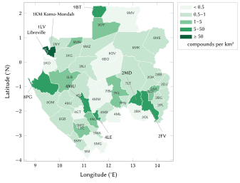
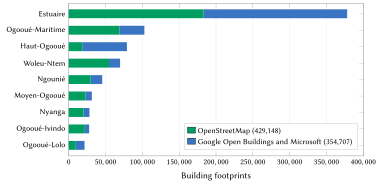
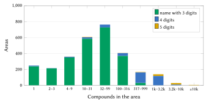
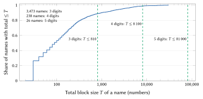
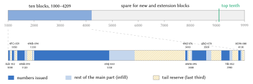
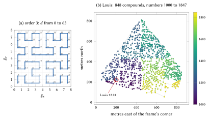
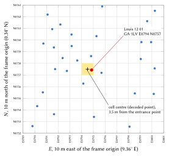

# Introduction

## The problem

An address tells a stranger where to go. In Gabon most homes have none that a stranger can use. The Universal Postal Union's addressing sheet for the country shows a two-digit number before the town, but no list of postcodes has ever been published and none is used in practice [@upu2002gabon]. Mail is delivered to post-office boxes (*boîtes postales*, BP), which identify a counter, not a home [@gabonreview2020bp]. Libreville began naming its streets and numbering its doors between 2012 and 2014 and relaunched the work in 2021, yet in 2024 the press still described "the capital of streets with no name", where residents give directions such as "behind the prison, to the left of the shop" [@mouega2021adressage; @obiang2024rues]. Elsewhere in the country, no programme of street addressing could be found.

The consequences are ordinary and costly. A delivery or a taxi ride ends with a telephone call; an ambulance reaches the quarter and then searches for the gate; a bank or an employer asks for an address that cannot be written down; a family abroad sends goods to a description. In the peri-urban quarters and along the national roads and rivers, compounds of several buildings share one gate, and villages extend for kilometres without a named street.

Conventional street addressing, as practised in many African cities since the 1990s, names streets, numbers doorways and maintains an address directory [@farvacque2005]. It is effective where it is completed and used, but it is slow and depends on signs that must be installed and maintained. Its average cost in a World Bank review of 21 cities was US\$5.7 per addressed doorway at 2005 prices [@farvacque2005].

## Contribution

This paper presents a national addressing model for Gabon and the registry built from it. Its contributions are:

1. **A code that people can say and remember.** A code is the name of a place people already use and a number of at most five digits, read in pairs like a telephone number: *Louis 12 01*.
2. **National uniqueness without context.** Each name owns one national range of numbers, cut into frozen blocks, one per area that carries the name, so that a code identifies one compound in the whole country with no town, province or device position.
3. **Locality and growth.** Numbers follow a Hilbert curve over each area, leave gaps for new homes and keep a reserve, so neighbours have neighbouring numbers and new compounds can be numbered between them.
4. **Integrity for systems.** A machine form carries a Damm check digit over the name, the département, the area and the number, which detects every single-digit error and every transposition of adjacent digits.
5. **Complete, open coverage.** All 665,089 compounds identified in the country received a code on 21 October 2026. The specification, the reference engine, the registry and a ready-to-deploy server are published under open licences [@nways2026repo].
6. **Evaluation and impact.** We measure the properties of the issued codes and estimate, under stated assumptions, their effect for citizens, logistics, emergency services and government.

## Structure of the paper

Section 2 reviews existing postal, addressing and land systems in Gabon and international practice. Section 3 describes the data. Section 4 sets out the model, rule by rule, with a worked example on a real code for each formula. Section 5 describes the implementation and Section 6 the evaluation. Section 7 reports the designs we considered and rejected, with measurements. Sections 8 to 11 estimate the benefits for citizens, logistics and commerce, emergency services, and government. Section 12 discusses privacy, safety and governance, Section 13 the limitations, and Section 14 concludes.

# Background and related work

## Territory and population

Gabon has nine provinces, numbered GA-1 (Estuaire) to GA-9 (Woleu-Ntem) in ISO 3166-2. The United Kingdom's Permanent Committee on Geographical Names counts fifty départements at the second level [@pcgn2023gabon]; OpenStreetMap maps 49 of them, the set used in this work. French is the official language, and Fang, Punu, Nzebi, Myene and many other languages are spoken at home. The 2026 general census counted 3,518,621 inhabitants, a total approved by the Constitutional Court on 27 August 2026 and almost double the 1,811,079 of 2013; roughly 60 % of the population lives in the Estuaire, around Libreville, Owendo and Akanda [@mouega2026recensement; @mbeng2026population]. Port-Gentil, Franceville, Oyem and Moanda are the next largest towns.

## Post and the post-office box

The UPU sheet gives two examples [@upu2002gabon]. For home delivery, "05 TCHIBANGA 01" follows the delivery information; for box delivery, "BP 13210" is followed by "01 LIBREVILLE–GROS-BOUQUET 03". The sheet labels the line "postcode and delivery office". The leading digits coincide with the ISO numbers of the provinces (Nyanga is GA-5, Estuaire GA-1); the sheet does not state this, and it is our inference. The trailing digits identify the delivery office. No list of these codes has been published and we found no current use of them. A post-office box can serve as a company's legal domicile, and since 2020 boxes can be requested online [@gabonreview2020bp]. A box locates a counter, not a dwelling.

## Street names and door numbers in Libreville

Libreville's addressing programme started in 2012–2014. On 8 July 2021 the interim mayor relaunched it with 480 million FCFA from the International Association of Francophone Mayors (AIMF) and the European Union; of 6,000 street plates produced, 3,900 had yet to be installed, and of 60,000 door numbers required, 55,000 had yet to be placed [@mouega2021adressage; @gabonactu2021adressage]. In May 2024 the programme, which aimed to name 3,650 roads, had not entered daily use [@obiang2024rues]. OpenStreetMap holds 3,945 doors with a street and a number in Libreville, Owendo and Akanda, of which 911 are tagged as surveyed. We found no comparable programme in any other town.

## Land, cadastre and the absence of an address register

The Agence nationale de l'urbanisme, des travaux topographiques et du cadastre (ANUTTC) manages land titles, re-marking and boundary corrections; it publishes no open parcel data [@anuttc]. The national projection for cadastre and survey is WGS 84 / Gabon TM 2011 [@epsg5523]. A land title identifies a parcel and a right; it does not tell a courier where to stop, and most homes have none. We found no national address register, no addressing law and no national address geoportal.

## International practice

The UPU's S42 standard describes the components of postal addresses and a template per country [@upuS42], and ISO 19160-1 provides a conceptual model of address data, including aliases and life cycle [@iso19160]. Both describe addresses; neither creates them where none exist. The UPU's 2012 white paper argues that an address is part of national infrastructure and of a person's social and legal identity [@upu2012addressing]. The World Bank's review of street addressing documents 52 cities in 15 countries between 1989 and 2004: in the 21 cities that completed their operations, 1.2 million buildings were addressed at an average of US\$0.6 per inhabitant, and the address directory produced a list of premises more complete than the tax rolls [@farvacque2005]. The same review shows that addressing decays when people do not use it, which motivates our choice to start from names people already use.

## Grid codes and national digital addresses

A second family of systems derives a code from coordinates. Open Location Code (Plus Codes) encodes a point with a 20-symbol alphabet; the compound *Louis 12 01* lies in the cell 6FGFCC5J+CH, about 14 m across [@olc]. In the region, Ghana's National Digital Property Address System divides the country into 5 m squares and derives an alphanumeric code such as GA-543-0125 [@bokpe2017ghana]. Grid codes cover every point at once and need no survey, but they address cells rather than homes, mix letters and digits that must be spelled, and carry no place name a listener can recognise. Section 7 compares these forms with ours. We retain a grid code for points that are not compounds (a stall, a field, a landing stage) but do not use it as the address of a home.

## The rule adopted: official addresses first

Where the State or a commune gives an address, the model shows that address first, exactly as written, and the code beside it. In Libreville the named street within 30 m of a compound is shown first on 37,622 compounds; a door number from the commune's plan replaces it once known (from the commune's data, from surveyed OpenStreetMap doors, or confirmed by residents). Each département keeps a reserved field for a postcode, to be filled when one is published. No code changes when an official address appears.

# Data and sources

All inputs are open data; Table 1 lists them. The figures in this paper are computed from the published registry and model files and can be reproduced from the repository [@nways2026repo].

| Input | Source | Licence | Use |
|:------|:------------|:-----|:--------|
| Building footprints | OpenStreetMap [@haklay2008osm; @geofabrik2026gabon] | ODbL 1.0 | structures (429,148) |
| Building footprints | Google Open Buildings [@sirko2021openbuildings], Microsoft [@microsoft2023footprints], via Overture Maps [@overture2026buildings] | CC BY 4.0 / ODbL 1.0 | structures not overlapping an OpenStreetMap building (354,707) |
| Walls, fences, hedges, gates | OpenStreetMap | ODbL 1.0 | compound enclosures (179 used in validation) |
| Places | OpenStreetMap places; GeoNames populated places [@geonames] | ODbL 1.0 / CC BY 4.0 | the 4,922 code areas |
| Départements | OpenStreetMap administrative boundaries | ODbL 1.0 | the 49 zones |
| Named streets | OpenStreetMap highways in Libreville | ODbL 1.0 | official street shown first |
| Facilities | OpenStreetMap and other open place datasets | various open | access to services (Section 11) |

: Inputs of the model.

**Building footprints.** We take every OpenStreetMap building inside Gabon and add the Google and Microsoft footprints that no OpenStreetMap building overlaps. The machine-learned footprints double the coverage in Estuaire and are the majority in Haut-Ogooué, where the OpenStreetMap map is sparse (Figure 2). Footprints under 1 m² are discarded. The machine-learned height attribute is a rendering value and is never used to infer floors.

{width=88%}

{width=88%}

**Places and names.** A code area is a named place of a département: an OpenStreetMap place (city, town, quarter, suburb, neighbourhood, village, hamlet, locality) or a GeoNames populated place. A GeoNames place within 1 km of an OpenStreetMap place of the same name is treated as the same place, and a second place of one name within 300 m is dropped. Only 88 suburbs and 49 quarters are mapped in the whole country, so several towns are represented by a single point; we return to this in Section 13.

**Boundaries.** The 49 département polygons (Figure 1) are frozen with the registry. Provinces are derived from a compound's position and are not part of any code.

# The model

## Requirements

The model was designed against eleven requirements, in order of priority: (i) a code is easy to say, hear and remember, and obtaining it takes one action; (ii) it is unique nationally on its own; (iii) it identifies a compound and leads to its gate; (iv) official addresses come first where they exist; (v) it uses the language people use; (vi) it cannot be mistaken for a post-office box, a telephone number or a land title; (vii) it can be resolved offline; (viii) it is stable and never reused; (ix) it describes places, never people; (x) it is open and can be transferred to the State; and (xi) it is specific to Gabon and shares no code with any other country's scheme.

## The forms of a code

A code has several forms, listed in Table 2. People use the remembered form; systems use the machine form.

| Form | Example | Used by |
|:------|:-----------|:-----------|
| Remembered | **Louis 12 01**, said "Louis, douze, zéro un" | people: said, typed, written on a parcel |
| Five digits | **Port-Gentil 12 181**, said "douze, cent quatre-vingt-un" | the largest and most repeated names |
| Three digits | **Abongo 181**, said "cent quatre-vingt-un" | small areas |
| Machine | `GA-1LV-070-1201-1` | applications, QR codes, partners; the final digit is the check |
| Structure, entrance | `GA-1LV-070-1201-1.2/1` | a building of the compound; one of its gates |
| Spot | `GA-1LV E0794 N0757` | any point: a stall, a field, a landing stage |
| Official | *Avenue Joseph Deemin, Libreville*; a door number once known | the commune's address, shown first |

: The forms of one code.

Let $P$ be an area's plate name and $N$ its number of three, four or five digits. The remembered form is $P$ followed by $N$ grouped from the left in pairs (four digits: $AB\,CD$; five: $AB\,CDE$; three: $ABC$). The machine form is

$$
\texttt{GA-}Z\texttt{-}I\texttt{-}N\texttt{-}c,
\tag{1}
$$

where $Z$ is the département's three-character key (Section 4.3), $I$ the three-digit index of the area in its département, and $c$ the check digit of Section 4.10. A plate name never contains a digit, so the number always begins at the first digit of the text.

## Départements and code areas

Each département has a key of three characters, its province's ISO number followed by two letters (**1LV** Libreville, **8PG** Bendje with Port-Gentil, **9OY** Woleu with Oyem), so that a postal clerk reading 1LV sees the Estuaire as on the 2002 UPU sheet. Each also has a frozen index $z \in \{0, \dots, 48\}$.

Each footprint $f$ belongs to the nearest place point of its own département. With $(\lambda, \varphi)$ for longitude and latitude in degrees and $\mathcal{A}_{z(f)}$ the areas of the footprint's département,

$$
a(f) = \operatorname*{arg\,min}_{a \in \mathcal{A}_{z(f)}} \left[ (\lambda_f - \lambda_a)^2 \cos^2 \varphi_f + (\varphi_f - \varphi_a)^2 \right],
\tag{2}
$$

ties going to the lower area key. Of the 4,922 areas, 2,932 contain at least one compound. The largest, Le Transfo in Port-Gentil, holds 13,031 compounds; Libreville has 114 areas and 191,073 compounds, and Port-Gentil 104 areas and 65,469 compounds. Figure 3 shows the distribution of area sizes. Each area is frozen at first issue: its key, its block of numbers and its *frame*, the bounding box of its footprints' centres widened by 0.0005° on each side, over which its numbers are laid out.

{width=88%}

## Plate names

The name in a code is a *plate name*, short enough to paint on a gate and to say in one breath. With $\mathrm{NFC}(s)$ the Unicode-normalised name, $W(s)$ its words and $L$ the French linking words *de, du, des, d, la, le, les, l, et, sur, en, au, aux, à*, a plate name must satisfy

$$
\mathrm{ok}(s) \iff |\mathrm{NFC}(s)| \le 12 \;\wedge\; |W(s) \setminus L| \le 2 \;\wedge\; s \text{ contains no digit}.
\tag{3}
$$

A name that fails Eq. (3) goes through fixed steps, the first that succeeds being kept: cleaning (brackets; the generic words *Quartier*, *Carrefour*, *Cité*, *Campement*, *Village*, so that "Cité Damas" becomes **Damas**); abbreviating "Saint" to "St"; and taking the most distinctive run of whole words, only when it is clearly ahead. A word is never cut. A list of ordinary French words (*mission*, *catholique*, *carrefour*, *institut*, *sports*, *cimetière*, *poteau*, …) counts as weak, so a short form keeps the proper name ("Mongo Milando" becomes **Milando**) and never the landmark word alone. Where every short form would contain a digit, consist only of ordinary words or equal another city's name, the area carries its département's chief town as a provisional name until the commune chooses ("Institut des Sports" is provisionally **Libreville**).

Three further rules fix the spelling. Spelling variants of one name (accents, case, hyphens) take one plate: the one that fits, then the one with its accents ("Akébé-Ville", not "Akebe Ville"), then the one more people live under. Capitals in the sources are written as names (MIMBOTI becomes **Mimboti**) except the acronyms of companies and public bodies (SETRAG, SOMIMA). A documented spelling wins over a map's: **Mont-Bouët**, as the city and the press write it, rather than "Mont Bouet".

| Areas | Count |
|:---------------|-----:|
| Plate name equal to the official name | 4,508 |
| Cleaned / shortened to distinctive words / abbreviated | 22 / 132 / 8 |
| Provisional, left to the commune with candidates | 252 |
| of which still over the limit of Eq. (3) | 115 |
| Official names over 12 characters or 2 words | 406 |

: Outcome of the plate-name rules for the 4,922 areas.

The 252 provisional names (Table 3) cover 87,684 compounds, which are numbered under a name their commune may change once. The official name always remains an alias (261 aliases are kept; 5 are dropped because two plate names claim them), so typing the full name finds the same compound.

## The name key

Two spellings denote the same name when they have the same *key*:

$$
\mathrm{key} = \mathrm{squeeze} \circ \mathrm{fold} \circ \mathrm{join} \circ \mathrm{article} \circ \mathrm{head} \circ \mathrm{saint} \circ \mathrm{upper} \circ \mathrm{unaccent}.
\tag{4}
$$

| Step | Rule | Example |
|:------|:---------------|:----------|
| unaccent, upper | diacritics and case removed | Akébé → AKEBE |
| saint, head, article | St, Ste → Saint, Sainte; a leading *Quartier* or *Village de* and *le, la, les, l'* dropped | Quartier Louis → LOUIS |
| join | every character outside A–Z and 0–9 removed | Nzeng-Ayong → NZENGAYONG |
| fold | tch, ch → c; dj → j; gh → g; ph → f; ck → k; ou, w → u; gu before i or e → g | Mont-Bouët = Mont Bouet; Mbogha = Mboga |
| squeeze | a doubled letter written once; digits never squeezed | Kotto = Koto |

: The steps of the name key, Eq. (4).

Folding can only merge names, never split one (Table 4). The 4,922 areas carry 3,737 distinct plate names; 713 names are shared, by 1,898 areas. Mandji is carried by 18 areas, Aléné by 11, the provisional name Libreville by 10, and Bissobinam, Mbomo and Moukouagna by 9 each.

## National name ranges

Every name owns one national range: 100–999, 1000–9999 or 10000–99999. The capacity rule is that an area's block holds at least twice its compounds. For an area with $c$ compounds,

$$
B(c) = \max\!\left(20,\; 10 \left\lceil \frac{2c}{10} \right\rceil \right).
\tag{5}
$$

For a name whose areas have $c_1, \dots, c_k$ compounds, taken in the frozen order of their keys (département, then area index), the total and the number of digits are

$$
T = \sum_{i=1}^{k} B(c_i), \qquad
d = \min\left\{ d' \in \{3, 4, 5\} \;:\; T \le \left\lfloor 0.9 \cdot 9 \cdot 10^{d'-1} \right\rfloor \right\},
\tag{6}
$$

so the limits are 810, 8,100 and 81,000 and the top tenth of every range is always spare. The blocks are laid end to end from $10^{d-1}$. Areas with no compound receive no block until their first compound.

**Worked example: Louis.** A single area of Libreville carries the name, with $c = 848$ compounds. Eq. (5) gives $B = 10 \lceil 1696/10 \rceil = 1700$, so the block is 1000–2699. Since $810 < T = 1700 \le 8100$, Eq. (6) gives $d = 4$, and 2700–9999 remain spare.

**Worked example: Le Transfo,** the largest area, $c = 13{,}031$: $B = 26{,}070$, block 10000–36069, $d = 5$, with 36070–99999 spare.

**Worked example: Mandji,** the most repeated name. Of its 18 areas, 10 contain compounds; their blocks total $T = 3{,}210 \le 8{,}100$, so the name has four digits and its blocks occupy 1000–4209 (Figure 5). **Mandji 10 20** lies in Ogooué-et-Lacs and **Mandji 39 50** in Offoué-Onoye: the number alone determines the area.

{width=88%}

{width=100%}

Table 5 gives the result for 2026: 2,505 areas have three digits, 368 four and 59 five. No name needs a qualifier and no area had to be split (Figure 4). **Growth.** A new area with an existing name, or an area whose block is full, takes the next block above every block of its name; blocks never move, shrink or get renumbered.

| Digits | Areas | Compounds | Share of compounds |
|:--|--:|--:|--:|
| 3 | 2,505 | 126,930 | 19.1 % |
| 4 | 368 | 332,650 | 50.0 % |
| 5 | 59 | 205,509 | 30.9 % |

: Digits of the issued numbers.

## Numbering within an area

Compounds are numbered along a Hilbert curve [@hilbert1891] of order $k = 16$ laid over the area's frame $(x_0, y_0, x_1, y_1)$, at each compound's reference point (the centre of its largest building until a gate is confirmed). The point is first mapped to the grid

$$
g_x = \left\lfloor \frac{\lambda - x_0}{x_1 - x_0} \,(2^k - 1) \right\rfloor, \qquad
g_y = \left\lfloor \frac{\varphi - y_0}{y_1 - y_0} \,(2^k - 1) \right\rfloor.
\tag{7}
$$

Its distance $h$ along the curve is then accumulated over $s = 2^{k-1}, 2^{k-2}, \dots, 1$, starting from $h = 0$:

$$
\begin{gathered}
r_x = \left\lfloor g_x / s \right\rfloor \bmod 2, \qquad
r_y = \left\lfloor g_y / s \right\rfloor \bmod 2, \qquad
h \leftarrow h + s^2 \left( 3 r_x \oplus r_y \right), \\
(g_x, g_y) \leftarrow
\begin{cases}
(g_y,\, g_x) & \text{if } r_y = 0 \text{ and } r_x = 0,\\
(2^k - 1 - g_y,\; 2^k - 1 - g_x) & \text{if } r_y = 0 \text{ and } r_x = 1,\\
(g_x,\, g_y) & \text{if } r_y = 1,
\end{cases}
\end{gathered}
\tag{8}
$$

where $\oplus$ is the bitwise exclusive or. The Hilbert curve preserves locality better than other common orders [@moon2001hilbert], so compounds close on the ground receive close numbers (Figure 6; Section 6.5 measures it).

Let the area's block be $[F, F + B)$ and let its $n$ compounds be sorted by $(h, \text{stable id})$ and indexed $i = 0, \dots, n - 1$. The numbers are

$$
M = \left\lfloor \tfrac{2B}{3} \right\rfloor, \qquad
\sigma = \max\!\left(1,\; \left\lfloor \frac{M}{\lfloor 1.5\, n \rfloor} \right\rfloor \right), \qquad
N_i = F + i\,\sigma,
\tag{9}
$$

and the tail reserve $[F + M, F + B)$ is left unused at first issue. Because $n \le B/2$ by Eq. (5), the last number $F + (n-1)\sigma$ always lies in the main part.

**Worked example: Louis 12 01.** The compound's reference point is $\varphi = 0.4085002$, $\lambda = 9.4314043$, and the frame of Louis is $(9.429597,\ 0.406494,\ 9.437690,\ 0.414309)$. Eq. (7) gives

$$
g_x = \left\lfloor \frac{0.0018073}{0.008093} \cdot 65\,535 \right\rfloor = 14\,635, \qquad
g_y = \left\lfloor \frac{0.0020062}{0.007815} \cdot 65\,535 \right\rfloor = 16\,823,
$$

and Eq. (8) gives $h = 896\,033\,648$, the 202nd of 848 positions along the curve ($i = 201$). With $B = 1700$, Eq. (9) gives $M = 1133$, $\sigma = \max(1, \lfloor 1133 / 1272 \rfloor) = 1$, and $N = 1000 + 201 = 1201$; the tail reserve is 2133–2699.

{width=100%}

## New compounds

A compound built after first issue is placed on the curve by Eq. (8). Let $a$ be the number of its predecessor on the curve (every issued compound counts, retired ones included; $a = F - 1$ if none) and $b$ that of its successor ($b = F + M$ if none), and let $\Phi$ be the free numbers $x$ with $a < x < b$ and $F \le x < F + M$. With $m = \lfloor (a + b)/2 \rfloor$, the new number is

$$
x^{*} = \operatorname*{arg\,min}_{x \in \Phi} \big( |x - m|,\; [x > m] \big),
\tag{10}
$$

that is $m$, then $m - 1$, $m + 1$, $m - 2$, … If $\Phi$ is empty, the lowest free number of the tail reserve is used, then the lowest free number of the area's later blocks, and finally a new block of size $B(n + 1)$ from the name's spare, above every existing block. A number is never given twice: retired numbers remain used. In Louis the step is 1, so a house built between two neighbours receives **Louis 21 33**, the first number of the tail reserve.

## Decoding without context

A text is read as a name and a number of three to five digits, with or without spaces. With $K(a)$ the keys of an area's plate name and aliases, $d(a)$ the digit count of its name and $\mathcal{B}(a)$ its blocks, the decoded set is

$$
D(P, N) = \left\{ a \;:\; \mathrm{key}(P) \in K(a),\; |N| = d(a),\; N \in \mathcal{B}(a) \right\},
\tag{11}
$$

which by construction holds at most one area. A number in no block, in a name's spare or with the wrong number of digits is reported as not issued, never guessed. Decoding uses no context: neither the user's position, nor the device's region, nor a town written after a comma.

## The check digit

The check digit is computed with Damm's algorithm [@damm2004; @damm2007] over the concatenation

$$
\delta = i_5 \,\Vert\, z_3 \,\Vert\, I_3 \,\Vert\, N, \qquad
c_0 = 0, \quad c_j = Q[c_{j-1}][\delta_j], \quad c = c_{|\delta|},
\tag{12}
$$

where $i_5$ is the name's national index on five digits, $z_3$ the département's index, $I_3$ the area index and $Q$ the table of a totally anti-symmetric quasigroup of order 10 (Table 6).

| $Q$ | 0 | 1 | 2 | 3 | 4 | 5 | 6 | 7 | 8 | 9 |
|:-:|:-:|:-:|:-:|:-:|:-:|:-:|:-:|:-:|:-:|:-:|
| **0** | 0 | 3 | 1 | 7 | 5 | 9 | 8 | 6 | 4 | 2 |
| **1** | 7 | 0 | 9 | 2 | 1 | 5 | 4 | 8 | 6 | 3 |
| **2** | 4 | 2 | 0 | 6 | 8 | 7 | 1 | 3 | 5 | 9 |
| **3** | 1 | 7 | 5 | 0 | 9 | 8 | 3 | 4 | 2 | 6 |
| **4** | 6 | 1 | 2 | 3 | 0 | 4 | 5 | 9 | 7 | 8 |
| **5** | 3 | 6 | 7 | 4 | 2 | 0 | 9 | 5 | 8 | 1 |
| **6** | 5 | 8 | 6 | 9 | 7 | 2 | 0 | 1 | 3 | 4 |
| **7** | 8 | 9 | 4 | 5 | 3 | 6 | 2 | 0 | 1 | 7 |
| **8** | 9 | 4 | 3 | 8 | 6 | 1 | 7 | 2 | 0 | 5 |
| **9** | 2 | 5 | 8 | 1 | 4 | 3 | 6 | 7 | 9 | 0 |

: Damm's quasigroup table $Q$: row $c_{j-1}$, column $\delta_j$.

**Worked example.** Louis has national index 1801, Libreville's index is 003 and the area's index 070, so $\delta = 01801\,003\,070\,1201$. The successive values of $c_j$ are 0, 3, 2, 4, 1, 7, 8, 8, 9, 7, 8, 4, 2, 4, 1, so $c = 1$ and the machine form is `GA-1LV-070-1201-1`.

Every single-digit error and every transposition of two adjacent different digits changes the check [@damm2007], a property first obtained for decimal codes by Verhoeff with the dihedral group [@verhoeff1969]. Because the name's index, the département and the area enter $\delta$, a number moved to another area of the same name fails both the check and the block test of Eq. (11). The check appears only in the machine form; it is never shown to people or asked of them.

## Spot codes

Any point has a spot code on a 10 m grid over its département's frozen frame, whose origin $(\lambda_0, \varphi_0)$ is the south-west corner of the département's bounding box floored to 0.01°, and whose reference latitude $\varphi_c$ is the box's centre rounded to 0.01°. With $k_x$ and $k_y$ the metres per degree,

$$
k_x = 111\,320 \cos \varphi_c, \qquad k_y = 110\,574,
\tag{13}
$$

$$
X = \left\lfloor \frac{(\lambda - \lambda_0)\, k_x}{10} \right\rfloor, \qquad
Y = \left\lfloor \frac{(\varphi - \varphi_0)\, k_y}{10} \right\rfloor,
\tag{14}
$$

and the code is $\texttt{GA-}Z\ \texttt{E}X\ \texttt{N}Y$, with four digits per axis, or five where the département spans more than 99.99 km. Decoding returns the cell centre $\hat\lambda = \lambda_0 + 10 (X + \tfrac12)/k_x$, $\hat\varphi = \varphi_0 + 10 (Y + \tfrac12)/k_y$, so the error is bounded by half the cell's diagonal:

$$
\left\| (\hat\lambda, \hat\varphi) - (\lambda, \varphi) \right\| \le 5\sqrt{2} \approx 7.07 \text{ m}.
\tag{15}
$$

**Worked example.** For Louis 12 01 in Libreville's frame ($\lambda_0 = 9.36$, $\varphi_0 = 0.34$, $\varphi_c = 0.45$): $k_x = 111\,317$, $X = \lfloor 0.0714043 \cdot 111\,317 / 10 \rfloor = \lfloor 794.85 \rfloor = 794$ and $Y = \lfloor 0.0685002 \cdot 110\,574 / 10 \rfloor = \lfloor 757.43 \rfloor = 757$, giving `GA-1LV E0794 N0757`. The decoded centre lies 3.5 m from the reference point (Figure 7).

{width=72%}

**Points in no outline.** The département outlines are generalised, so 80 issued compounds lie in no outline: in slivers between départements, on the shoreline and on islands, the farthest 18.4 km from an outline. Such a point takes its département from those whose outline lies within 20 km: among them, the one with the nearest outline whose frame holds the point, distances being measured to the nearest edge with longitude differences scaled by $\cos\varphi$ and ties going to the lower key; if no such frame holds it, the nearest cell of a frame at most 1,000 m away. Frames are never moved or widened, because either would change spot codes already published, and the decoder is unchanged, since a spot code names its département. Every issued compound therefore has a spot code. For example, a compound of Moka at $\varphi = 0.8104524$, $\lambda = 9.3792151$, on an island 18.4 km from the nearest outline, that of Komo-Mondah, falls in Komo-Mondah's frame and receives `GA-1KM E0881 N6971`.

## From footprints to compounds

A code belongs to a compound, not to a building. Footprints are grouped one area at a time, in a fixed order by stable id, before any number is given. With $\mathrm{dist}(a, b)$ the shortest distance between two outlines (zero when they touch or overlap) and $A(f)$ the area of footprint $f$, an annex $f$ with $A(f) < 25$ m² joins

$$
g^{*}(f) = \operatorname*{arg\,min}_{g \,:\, A(g) \ge 25 \text{ m}^2,\ \mathrm{dist}(f, g) \le 8 \text{ m}} \mathrm{dist}(f, g).
\tag{16}
$$

The full rules are in Table 7. Only annexes join a house, and a hut cluster never joins two houses, so groups cannot chain.

| Rule | Condition | Effect |
|:----|:---------------|:--------|
| Enclosure | the footprint's centre lies inside a mapped closed wall, fence or hedge of at most 6,000 m² | the enclosure is one compound |
| Annex | a footprint under 25 m² (kitchen, wash house, store) | joins its house by Eq. (16) |
| Hut cluster | outside Libreville and Bendje: huts under 40 m² belonging to no house, at most 3 m apart | one compound of at most 25 huts |
| Single | any other footprint | its own compound |

: Grouping rules, applied in order.

The 783,855 footprints form 665,089 compounds, 1.18 footprints per compound: 566,928 single buildings, 92,635 houses with their annexes, 5,288 hut clusters and 238 mapped enclosures. By size, 566,985 compounds are one structure, 82,186 two, 12,644 three and 3,274 four or more. The median footprint is 70 m². Table 8 gives the figures by province.

| Province | Compounds | Footprints | Median footprint |
|:--|--:|--:|--:|
| Estuaire | 327,833 | 378,121 | 72.5 m² |
| Ogooué-Maritime | 78,404 | 102,729 | 45.3 m² |
| Haut-Ogooué | 67,390 | 79,025 | 67.6 m² |
| Woleu-Ntem | 60,822 | 69,755 | 65.1 m² |
| Ngounié | 38,689 | 45,530 | 56.9 m² |
| Moyen-Ogooué | 26,887 | 31,351 | 55.7 m² |
| Ogooué-Ivindo | 24,046 | 27,749 | 60.6 m² |
| Nyanga | 22,724 | 28,169 | 48.8 m² |
| Ogooué-Lolo | 18,294 | 21,426 | 66.3 m² |

: Compounds and footprints by province.

The rules are deliberately conservative. Merging two codes later costs nothing, whereas splitting a wrong merge would give a household a new code. Residents' answers in the application ("these buildings are one home", "this is the gate") complete the grouping where walls are not mapped.

## Building profiles

Every structure carries a use class with a confidence and a source, its size, its number of floors where known, and a status. Classes are inferred in a fixed order: the OpenStreetMap building type (confidence 0.85), a shop, amenity or office tag on the footprint (0.75), an open place inside it (0.65), the footprint's size (0.3–0.4), and otherwise *residential* by default (0.45). Table 9 shows the result.

| Class | Structures |
|:---------------|-----:|
| residential (mostly the default) | 773,037 |
| annex | 5,501 |
| commercial | 1,946 |
| education | 725 |
| industrial | 600 |
| office | 510 |
| health | 400 |
| hospitality | 325 |
| religious | 269 |
| government | 119 |
| other (ruin, under construction, mixed, transport, agricultural) | 423 |

: Use classes of the 783,855 structures.

OpenStreetMap records floors for 491 buildings. A home never carries a name; business and public buildings carry their public names only.

# Implementation

## Reference engine

The specification (`engine/SPEC.md`) states every rule normatively. The reference engine (`engine/reference/ga_engine.py`) implements it in the Python standard library: name keys (Eq. 4), plate-name checks (Eq. 3), block sizes (Eqs. 5–6), the Hilbert index (Eqs. 7–8), numbering (Eqs. 9–10), decoding (Eq. 11), the check digit (Eq. 12), spot codes (Eqs. 13–15) and footprint grouping (Eq. 16). A second module derives plate names. The engine ships with the frozen register of areas, names, blocks and frames (`engine/data/`), about 3 MB, so that a device can resolve every code offline.

## Registry

The registry (`registry/`) publishes every issued code: one compressed CSV file per département with one row per compound (machine, remembered and written forms, area, number, check, status, issue date, entrance point, spot code, official address, use class, structures and floor area), the frozen area table, and a manifest giving each file's row count and SHA-256 digest. Every compound of every département is published; the rows contain nothing about the people who live there.

## Server and API

A ready-made server (`server/`) lets a ministry, a postal operator or a developer serve the registry in one command, with Docker or plain Python 3.9 and no third-party packages. It imports the registry into SQLite with indexes on every form and an R\*-tree spatial index [@guttman1984; @beckmann1990], verifying each file's digest and the totals against the manifest and refusing any mismatch. It serves a JSON API under `/v1`: lookup of a code in any form, the code at a point, codes near a point, validation, spot codes, départements, areas and paged lists, all described in OpenAPI 3.1 [@openapi31] with recorded examples. It can export the registry back in the published format; after an import, the decompressed export is byte-identical to the published files.

The server can also issue codes for new compounds and new entrances by the rules of Sections 4.8 and 4.12, but only where it has been designated as the country's issuer. Issuing must be done by one issuer per country: two issuers would see the same free number and give it to two homes. A deployment that has not been designated by the State or by N-WAYS LIMITED therefore runs read-only.

## Conformance and parity

An implementation conforms when it reproduces the conformance vectors published with the engine (`vectors.json`): 724 name keys, 500 code forms, 2,394 decodings with and without check digits, 588 spot codes, 310 points in no département outline (the 80 issued compounds among them, points beyond a frame and refusals), 5 Hilbert indices, 6 grouping cases and 4 numbering cases on a real area with new homes, 4,531 in all. The engine's 15 tests and the server's 31 tests pass. The server's issuing was checked against the issuer used in production on 62 issuance cases, 5 insertion cases and 300 random points, with identical results.

# Evaluation

Table 10 summarises the measured properties of the issued registry; the subsections give the details.

| Property | Measurement | Result |
|:-----|:------------|:-----------|
| Uniqueness | distinct machine forms; distinct remembered forms (by name key) | 665,089 and 665,089 of 665,089 |
| Ambiguity avoided | codes sharing name and number under per-area numbering | 150,090 (22.6 %), none with national ranges |
| Number length | mean digits per code; maximum | 4.12; 5 |
| Plate length | mean characters, areas in use; plates over 12 characters | 7.5; 75, all provisional |
| Decoding | written forms of 50,000 random codes; 20,000 typed in lower case without accents | 100 % and 100 % correct |
| Error detection | single substitutions; adjacent transpositions (2,000 codes) | 145,818 and 12,730, all detected |
| Spot codes | distance from reference point to decoded centre | mean 3.82 m, maximum 7.07 m |
| Reproducibility | areas whose issued numbers equal Eq. (9) recomputed from the registry | 2,932 of 2,932 |

: Measured properties of the registry issued on 21 October 2026.

## Uniqueness and ambiguity

All 665,089 machine forms are distinct, and so are the remembered forms, even after reducing each name to its key (Eq. 4). Of the 3,737 names, 373 are carried by more than one area that contains compounds; together these hold 259,144 compounds, 39 % of the total. Had each area been numbered from the start of its own range, as in the first design we considered (Section 7.2), 150,090 codes (22.6 %) would share their name and number with a code in another area, in 64,701 colliding pairs or groups. National ranges remove every such collision without adding a digit to any code that fits in five.

## Length

The mean number length is 4.12 digits, and no number exceeds five (Table 5). Plate names of the 2,932 areas in use have 7.5 characters on average, and 7.8 when weighted by the codes that carry them. Seventy-five plate names in use exceed 12 characters; all are provisional names awaiting a commune's choice, and they cover 17,122 compounds.

## Decoding

We decoded the written forms of 50,000 codes drawn at random from the registry, and 20,000 of them typed in lower case with every accent removed, as a person might type on a telephone. All decoded to their own machine form, with no false match.

## Error detection

For 2,000 random codes we formed every single-digit substitution and every adjacent transposition in the visible part of the machine form (area index, number and check). All 145,818 substitutions and 12,730 transpositions were detected, as the theory guarantees [@damm2007]. Errors outside that guarantee were also mostly caught: 89.7 % of 10,938 jump transpositions ($abc \to cba$) and 89.6 % of 13,248 twin errors ($aa \to bb$).

## Locality of numbering

We measured the distance on the ground between compounds with consecutive numbers in every area of at least 50 compounds in six départements (Libreville, Bendje, Woleu, Mpassa, Ogooué-et-Lacs and Douya-Onoye: 350,235 pairs). Table 11 compares the Hilbert order with a Morton (Z-order) curve and a raster of horizontal bands over the same grid.

| Order | Mean distance | 90th percentile | Pairs over 100 m |
|:--|--:|--:|--:|
| **Hilbert (used)** | **35.4 m** | **63.6 m** | **3.4 %** |
| Morton (Z-order) | 46.6 m | 86.1 m | 7.1 % |
| Raster in horizontal bands | 56.3 m | 68.2 m | 5.5 % |

: Distance between compounds with consecutive numbers, by curve.

The Hilbert order shortens the mean step by 24 % against Morton and 37 % against a raster, and halves the share of long jumps against Morton, consistent with its known clustering properties [@moon2001hilbert].

## Spot codes

Every one of the 665,089 compounds has a spot code. The decoded cell centre lies on average 3.82 m and at most 7.07 m from the reference point, the bound of Eq. (15); for the 80 compounds in no département outline, which take the département of the nearest outline (Section 4.11), it lies at most 6.65 m away. Re-encoding 50,000 points reproduced their published spot codes exactly.

## Compound grouping

We re-ran the grouping rules with the 179 walls and fences mapped around buildings removed from the input. 4.5 % of these enclosures came out as exactly one compound, and a further 25.1 % missed only one building. Behind a wall the main house, the rooms and the kitchen are often separate buildings; without a mapped wall the rules keep them apart by design, and residents' answers merge them.

## Real codes

Table 12 lists the compound nearest well-known places, as issued.

| Near | Code | Machine form | Spot code |
|:---------|:-------|:--------|:----------|
| Marché de Mont-Bouët, Libreville | Mont-Bouët 19 57 | GA-1LV-076-1957-3 | GA-1LV E1022 N0679 |
| Sainte-Marie cathedral, Libreville | Sainte-Marie 10 11 | GA-1LV-112-1011-9 | GA-1LV E0851 N0692 |
| Université Omar Bongo, Libreville | Sobraga 12 42 | GA-1LV-016-1242-0 | GA-1LV E0943 N0880 |
| The Senate, Libreville | Boys 11 20 | GA-1LV-040-1120-1 | GA-1LV E0657 N1044 |
| Stade Omar Bongo, Libreville | Libreville 22 402 | GA-1LV-067-22402-8 | GA-1LV E1028 N0573 |
| Quartier Louis, Libreville | Louis 12 01 | GA-1LV-070-1201-1 | GA-1LV E0794 N0757 |
| Stade de l'Amitié, Angondjé | Malibé 15 516 | GA-1KM-058-15516-3 | GA-1KM E1019 N3778 |
| Port of Owendo | Owendo Port 13 98 | GA-1KM-096-1398-4 | GA-1KM E2195 N1293 |
| Saint-Louis cathedral, Port-Gentil | Port-Gentil 12 181 | GA-8PG-042-12181-2 | GA-8PG E01071 N07265 |
| Albert Schweitzer Hospital, Lambaréné | Abongo 181 | GA-3LB-001-181-6 | GA-3LB E07571 N06549 |
| Saint-Hilaire cathedral, Franceville | St-Hilaire 15 33 | GA-2FV-032-1533-9 | GA-2FV E3755 N09047 |
| Stade de Moanda | Samba I 13 63 | GA-2MD-074-1363-9 | GA-2MD E4857 N2661 |
| Regional hospital, Koulamoutou | Koulamoutou 14 020 | GA-7KL-045-14020-8 | GA-7KL E06989 N08766 |
| Regional hospital, Makokou | Mvoungha 340 | GA-6MK-114-340-8 | GA-6MK E07872 N07524 |
| Saint-Charles-Lwanga cathedral, Oyem | Keng-Akok 13 059 | GA-9OY-175-13059-6 | GA-9OY E03123 N07931 |
| Market, Bitam | Bitam 26 24 | GA-9BT-058-2624-0 | GA-9BT E1946 N2866 |
| Saint-Jean cathedral, Mouila | Mouila 12 203 | GA-4MU-031-12203-3 | GA-4MU E3258 N2506 |

: Codes of the compounds nearest well-known places.

Two cases illustrate the rules. A partner's system that receives `GA-1LV-070-1210-1`, with two digits swapped, computes the check of 1210 as 4, not 1, and refuses the code instead of sending a courier to the wrong house. The texts `mandji 1020` and `mandji 3950` resolve to two different départements' blocks of the single Mandji range, with nothing to choose from a list.

## The server

On the full registry, import takes about 8 seconds and produces a 310 MB database; once decompressed, an export is byte-identical to the published files (the gzip containers themselves may differ in compression). A load test of 6,400 requests on 16 threads produced no error; typical latencies were about 1 ms for a lookup by code, 5 ms for the code at a point, and 100 ms for all codes within 200 m in central Libreville. For 150 random codes, all 24 fields returned by the server equal those of the operating N-Ways service. For the code at a point, the server agreed with the operating service on 153 of 200 random points: 36 differences arise because the published registry contains entrance points but not building outlines, so the server finds a compound only within 12 m of its entrance, while the operating service also matches anywhere inside the footprint; the remaining 11 are points north of 1.65° N at which the operating service returned no answer at the time of measurement because its country look-up did not resolve them; the published server, which serves Gabon alone, has no such step.

# Designs considered and rejected

## Code forms

The capacity rule is at least two numbers per compound. Table 13 compares the forms we considered for 665,089 compounds.

| Option | Example | Arithmetic | Assessment |
|:-------|:------|:---------|:------------|
| National digits only | 4817305 | $2 \times 665{,}089 = 1.33$ M, 7 digits | too long; says nothing about where |
| Département and digits | Libreville · 382 146 | Libreville: $2 \times 191{,}073$, 6 digits | too long, and the département must be said too |
| Town and letters | Libreville 7HQ2X | $20^5 = 3.2$ M | letters must be learnt and spelled; poor for people who read little |
| Plus Code | 6FGFCC5J+CH | a 14 m cell | letters and a plus sign; hard to dictate; names a cell, not a home |
| **Place name and number** | **Louis 12 01** | every area fits 5 digits | **chosen** |

: Code forms considered.

The limit of five digits follows the evidence on short-term memory. Miller's classic estimate of about seven items [@miller1956] has since been lowered to about four chunks for material that cannot be rehearsed [@cowan2001]. A number of four or five digits read in two groups, after a name that is already known, fits that limit; a sixth digit adds a third group.

## Per-area numbering

The first design we considered numbered each area independently, with four digits and a check digit on the plate (for example "LOUIS 2471-8"). Section 6.1 shows that it would have left 150,090 codes ambiguous, so that a town would have had to follow the code wherever names repeat. Giving each name one national range removed the ambiguity at the cost of one digit for some areas: 30.9 % of compounds have five digits, mostly in towns that the map knows by a single point (Port-Gentil, Mouila, Koulamoutou), where one area covers the whole town until its quarters are named.

## A check digit on the plate

A check character that detects every single error and every adjacent transposition requires either an eleventh symbol with a prime modulus or a quasigroup such as Damm's. We chose Damm's algorithm because it needs digits only, which read the same in every language. We removed the check from every form people see: a digit that carries no meaning for the speaker is the first to be dropped or garbled, and people's errors are caught instead by the block test of Eq. (11), which refuses most numbers that were never issued. Systems, which copy codes rather than remember them, verify the check.

## Curve

We compared the Hilbert order with a Morton curve and a banded raster (Table 11) and chose the Hilbert curve for its shorter steps and fewer long jumps.

## Spelling variants

Grouping spelling variants with the name key of Eq. (4) would write a doubled letter once and fold "gui" into "gi". Gabon's place names were therefore grouped by accents, case and punctuation only before any number was given ("Mabangui", not "Mabang I"; "Akomé II", not "Akome I"); the key is used for decoding, where merging can only help.

# Benefits for citizens

For a family in a compound of Nzeng-Ayong, in a lane of Mont-Bouët or in a village on the road to Oyem, a code changes four ordinary things. **Being found:** the person says one short phrase, and the visitor's application leads to the gate. **Proving where one lives:** banks, mobile-money agents, schools and employers ask for an address; a post-office box says nothing about a home. **Receiving goods and services:** families abroad, shops and utilities can send to a code instead of a description, and a household can request a connection or a repair at the right gate. **Simplicity:** obtaining a code requires no document and records no personal data; it is not a land title.

**Coverage.** Before issue, an address that a stranger could follow existed for at most 3,945 doors with a mapped street and number, and a named street within 30 m for 37,622 compounds (5.7 %). After issue, all 665,089 compounds have a code. With the 2026 census population of 3,518,621 [@mouega2026recensement], this is on average 5.3 people per compound, under the assumption that the compounds in the registry house the whole population; if 10 % of the population lives in compounds not yet mapped, the mean is 4.8.

**Time.** No measurement of the time Gabonese households spend guiding visitors exists. As an illustration under stated assumptions, let $H = 657{,}893$ residential compounds each receive $v$ visits a month that require guidance by telephone, and let a code save $\Delta t$ minutes per visit. The time saved per year is

$$
\Theta = 12\, H\, v\, \Delta t / 60 \ \text{hours}.
\tag{17}
$$

With $v = 2$ and $\Delta t = 5$ min, $\Theta \approx 1.3$ million hours a year; over $v \in [1, 4]$ and $\Delta t \in [2, 10]$ min, $\Theta$ ranges from 0.26 to 5.3 million hours. These values are assumptions to be replaced by the measurements proposed in Section 13.

**Who benefits most.** The people with the least today: unplanned quarters, villages far from the main roads, the tenants of a compound who share one gate, and people who read little, for whom a place they know and a few digits are easier than a street name. The UPU notes that an address is commonly tied to a person's identity and access to rights [@upu2012addressing].

# Logistics and commerce

Delivery in Gabon depends on the telephone and on drivers' local knowledge. Industry analysis of African last-mile delivery reports first-attempt success rates as low as 60 %, and an average cost of about US\$2.70 per last-mile attempt [@odeloye2023lastmile].

For a logistics business the code offers a stable customer key (the machine form), routing to the gate (or the main building until the gate is confirmed), fewer calls and failed trips, checked input (the check digit catches a mistyped code at once) and offline resolution with the open engine, without payment to N-Ways.

**Estimate.** Let $f_0$ be the share of first attempts that fail, $r$ the share of those failures that a precise, checkable address prevents, and $c$ the cost of an attempt. The saving per 1,000 deliveries is

$$
S = 1000\, f_0\, r\, c.
\tag{18}
$$

With $f_0 = 0.20$, $r = 0.5$ and $c = \text{US}\$2.70$, $S = \text{US}\$270$ per 1,000 deliveries. Over $f_0 \in [0.10, 0.40]$, the upper bound being the cited industry figure, and $r \in [0.25, 0.75]$, $S$ ranges from US\$68 to US\$810. Neither $f_0$ nor $r$ has been measured in Gabon.

**The port, the railway and the oil and mining towns.** Owendo's port and the Transgabonais railway carry the country's imports, manganese and timber; Port-Gentil and Moanda depend on oil and manganese. Importers, transporters, suppliers to production sites and the traders of Mont-Bouët can send goods and payments to a compound by code, and a company can record its staff's homes by code for transport and emergencies. La Poste can deliver to a gate, and every département already reserves a field for a postcode.

# Emergency services

An ambulance, a fire crew or a police patrol faces the same problem as a courier, with more at stake. A qualitative study of emergency medical services in Kigali found that crews and dispatchers lost time locating patients because they depended on the local knowledge of the caller and the crew and needed several calls to pass the location [@hunt2023ems]. In Gabon, emergency numbers are 177 for the police, 1300 for medical assistance, and 18 for the fire service from a landline or 112 from a mobile [@canada2026gabon; @selectra2026gabon]. In August 2021 a press investigation found that dialling 1300 returned an invalid-number message, and reported testimonies of crews saying they could not reach informal quarters [@alomo2021urgences]. We found no published measurement of the time spent locating a caller, which is itself a reason to begin measuring it.

**How a code helps a dispatcher.** The caller says one phrase ("Mandji, trente-neuf, cinquante"), and the registry returns one compound, not one of the other 17 areas named Mandji. The dispatcher reads back the place, its département and its gate. The crew drives to the gate; a spot code marks any point without a compound, such as a crash on the N1. The engine and the area table work offline.

**Estimate.** Larsen and colleagues modelled survival after witnessed out-of-hospital cardiac arrest as 67 % less 2.3 percentage points per minute before cardiopulmonary resuscitation (CPR), 1.1 per minute before defibrillation and 2.1 per minute before advanced care [@larsen1993]. If locating the gate delays all three by $\Delta t$ minutes, survival falls by

$$
\Delta P = (\beta_{\mathrm{CPR}} + \beta_{\mathrm{D}} + \beta_{\mathrm{A}})\,\Delta t = 5.5\,\Delta t \ \text{percentage points}.
\tag{19}
$$

If bystander CPR starts regardless, only defibrillation and advanced care are delayed and the coefficient is $1.1 + 2.1 = 3.2$. A saving of $\Delta t = 2$ minutes therefore corresponds to 6.4 to 11 points of survival for this group of patients. The model was estimated in King County, Washington, and is an order of magnitude for Gabon, not a prediction.

# Government coordination and planning

A code is a shared key. When ministries, communes, utilities and the statistics office refer to a compound by the same code, their records can be joined without matching names and descriptions.

**One reference for all services.** An address directory provides a list of premises more complete than a tax roll and shows who is missing from it [@farvacque2005]. In Libreville the registry and the commune's door numbers can be compared gate by gate; other communes can start from a registry of 665,089 compounds, each with a position and a code.

**A code that outlives reforms.** Provinces and départements are looked up from a compound's position and are not part of the remembered code. When a boundary moves, every code keeps working; the département in the machine form is frozen with the code.

**The census.** The 2026 census was organised in 3,322 enumeration areas and used geolocation in its fieldwork [@dzonteu2026recensement]. A table of codes against enumeration areas, about 200 compounds per area on average, would give the next census a frame of compounds to sample from and return to, and the registry its household counts, without storing any name.

**Access to services.** Table 14 gives straight-line distances from a random sample of 20,000 compounds to the nearest mapped facility.

| Facility | Within 2 km | Within 5 km | Median distance |
|:--|--:|--:|--:|
| Health facility | 59.3 % | 73.8 % | 1.4 km |
| School | 69.9 % | 79.8 % | 0.9 km |
| Police | 33.8 % | 56.0 % | 3.6 km |
| Pharmacy | 51.4 % | 63.9 % | 1.8 km |

: Distance from 20,000 compounds to the nearest mapped facility.

Gabon is largely urban, so most compounds are near a facility; the compounds beyond 5 km, a quarter for health and nearly half for police, are mostly in villages. These figures describe the map as much as the country: police posts are thinly mapped. A ministry can replace the facility list with its own and recompute the table.

**Cost avoided.** A conventional addressing operation covering the same compounds would cost, at the World Bank's average per addressed doorway $c_d = \text{US}\$5.7$ (2005 prices) [@farvacque2005],

$$
C = N_c\, c_d = 665\,089 \times 5.7 \approx \text{US}\$3.8 \text{ million},
\tag{20}
$$

or US\$1.9 to 7.6 million if the unit cost in Gabon were half or double the average. The figure excludes inflation since 2005 and the street signs that a conventional operation installs; the code does not replace street names where communes choose to install them, but it gives every compound an address in the meantime.

# Privacy, safety and governance

**Places, never people.** Codes describe places. Homes carry no names and no occupant data; business and public buildings carry their public names. Photographs submitted to register a new home are kept for verification only, and a household can ask for its gate to be hidden. No identity number is collected. Gabon's Loi n° 001/2011 on personal data, amended by Loi n° 025/2023 of 12 July 2023, applies, with the APDPVP as the supervisory authority [@loi2023donnees; @apdpvp]; the processing of the personal data held by the N-Ways application (telephone numbers, photographs) is declared to it, and transfers abroad follow the conditions the law sets.

**Everything is published, nothing about people.** The open registry lists every area and every compound of every département: the code, the entrance point and the building profile. Travel advice informs the safety guidance given with the codes; the United Kingdom's advice, for example, names no part of Gabon to avoid [@fcdo2026gabon]. It does not determine what is published. An address is neither a land title nor an eviction list. Data held beyond the registry, such as who confirmed a code and from which telephone, is released only on a court order, with a public report.

**Governance.** One issuer at a time maintains the registry, so that no two homes share a code. Areas, blocks and frames are frozen and codes never move; regrouping never changes an issued code. A commune may rename an area (the old name remains an alias), choose a provisional short name once, or add areas. The communes' addresses are theirs: they are shown as written, never edited, and mismatches observed on the ground are reported to the commune. Every code starts *provisional* and becomes *confirmed* when residents agree in the application (two telephones, at least one at the gate, and most answers in agreement), without manual review. The repository, the registry and the rules are designed to be handed to the State, or to a body it designates, under their open licences and without forking the engine.

# Limitations and future work

**Areas.** OpenStreetMap and GeoNames places are uneven (88 suburbs and 49 quarters mapped in the whole country), and towns mapped as a single point form large areas with five-digit numbers. Names and spellings need confirmation by residents and communes. The 252 provisional plate names, 115 of them still over the limit, await the communes' choice.

**Compounds and profiles.** Few walls are mapped, so most compounds are single buildings or a house with its annexes, and the grouping recovers whole enclosures poorly (Section 6.7). Use classes are mostly the default, and floors are almost always unknown.

**Gates and official addresses.** Most codes lead to the main building until a gate is confirmed. Door numbers of Libreville's plan are not open data; until the commune shares them, a named street is shown, and a door number only where OpenStreetMap or residents confirm it.

**Boundaries.** OpenStreetMap maps 49 départements where the PCGN counts 50 [@pcgn2023gabon], and the outlines are generalised: 80 compounds lie in no outline and take the département of the nearest outline for their spot code. The département in a machine form is frozen; a corrected boundary changes only lookups.

**Scope.** Codes are unique within Gabon; the application shows the country on every card.

**Measurements.** The estimates of Sections 8 to 11 rest on assumptions. Table 15 lists the measurements that would replace them.

| Measure | Method | Target |
|:-----------|:----------|:------|
| Recall of one's own code after one week | residents asked without the application | at least 80 % exact |
| Digit errors when dictating a code by telephone | recorded calls with partner couriers | under 5 % |
| First-attempt delivery success | partner couriers, with and without a code | at least 20 points higher |
| Time from arrival in the quarter to the gate | courier application timestamps | halved |
| Gates confirmed and door numbers attached | residents and couriers | 10,000 |

: Measurements planned to replace the assumptions of Sections 8 to 11.

# Conclusion

Gabon's homes can now be named by what people already say: a quarter or village and a short number. The model assigns one national range to each name, numbers compounds along a Hilbert curve with room to grow, and protects the machine form with a check digit that people never see. On 21 October 2026 all 665,089 compounds identified in the country received a code; the codes are unique, short, decodable without context and reproducible from the published data. The model complements rather than replaces official addressing: where the commune gives an address, that address comes first. The next steps are the communes' choice of the 252 provisional names, the confirmation of gates with residents and couriers, the integration of Libreville's door numbers, and the field measurements of Table 15.

# Data and code availability {-}

The specification, reference engine, conformance vectors, registry, server, the tools that built the data, the figure sources and this paper are published at <https://github.com/n-ways/open-addresses-gabon> [@nways2026repo]. Code is licensed under the Apache License 2.0, data under the Open Database License 1.0 and documents under CC BY 4.0. Any use should be credited as: "N-Ways Addressing for Gabon, © N-WAYS LIMITED (nways.ng)".

# Acknowledgements {-}

This work rests on open data. We thank the OpenStreetMap contributors in Gabon and elsewhere, GeoNames, Google Research for Open Buildings, Microsoft for its building footprints, and the Overture Maps Foundation for distributing them. Errors are ours.

# References {-}

::: {#refs}
:::
